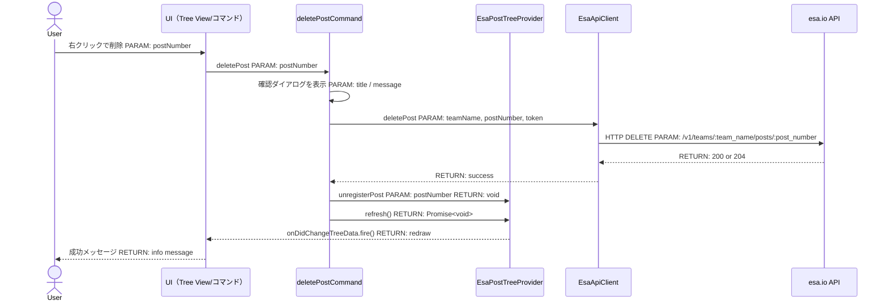
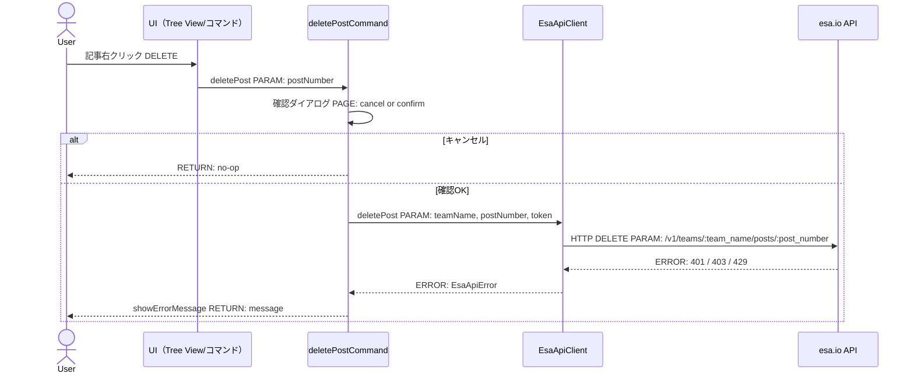
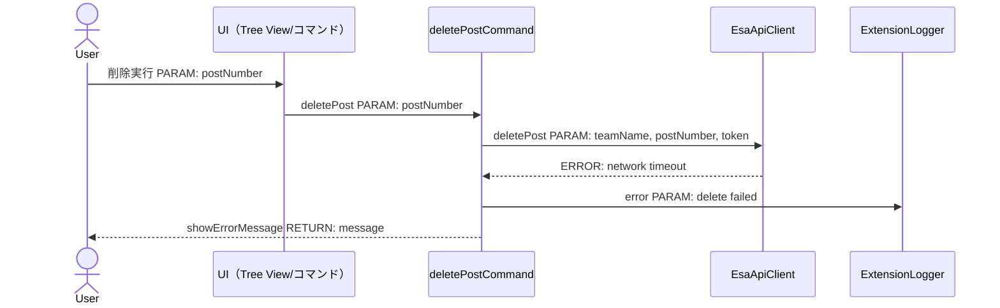
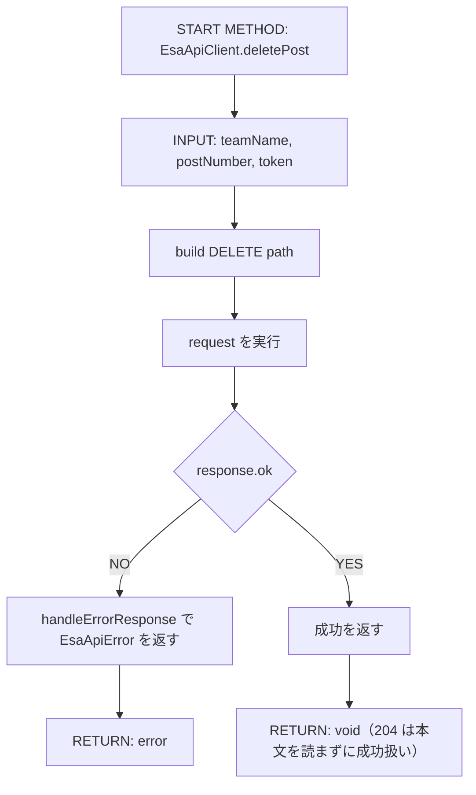

# 実装plan: 記事の右クリックメニューから削除

> 本plan は `.github/copilot/80-templates/implementation-plan.md` に準拠する。
> 本Issueは設計フェーズのため、コード実装・他ファイル編集は行わず、実装Agent へ引き渡す設計情報のみを記録する。

---

## 0. 実装入力コンテキスト

| 項目                             | 記入                                       |
| -------------------------------- | ------------------------------------------ |
| 対象Issue                        | [DESIGN] 記事の右クリックメニューから削除  |
| 対象リポジトリ内パス（実装起点） | src/, package.json, .github/copilot/plans/ |

### 0.1 変更サマリ一覧

| 区分（追加/修正/削除） | 対象（機能/コマンド/API）         | 変更概要                                                                 |
| ---------------------- | --------------------------------- | ------------------------------------------------------------------------ |
| 追加                   | esaExplorer.deletePost コマンド   | 記事の右クリックメニューから削除を開始するコマンドを追加                 |
| 追加                   | package.json の contributes.menus | view/item/context に削除項目を追加                                       |
| 追加                   | EsaApiClient.deletePost           | DELETE /v1/teams/:team_name/posts/:post_number を呼ぶ API メソッドを追加 |
| 修正                   | deletePostCommand                 | 確認ダイアログ、認証取得、API 呼び出し、ツリー再読込の責務をまとめて実装 |
| 修正                   | EsaPostTreeProvider               | 削除後に localPosts と再取得済み一覧が整合するよう更新する               |
| 修正                   | PostCache                         | 削除対象記事をキャッシュから除去する                                     |
| テスト                 | src/test/**                       | 正常系 / キャンセル / API 失敗 / 境界値を追加                            |

### 0.2 入力制約一覧

| 制約区分（互換性/禁止事項/期限/その他） | 制約内容                                                           | 適用対象          |
| --------------------------------------- | ------------------------------------------------------------------ | ----------------- |
| 互換性                                  | 既存の 「Markdownで開く」「esa.ioで開く」導線は維持する            | UI / commands     |
| 禁止事項                                | 削除前の確認ダイアログを省略して API を呼ばない                    | deletePostCommand |
| 禁止事項                                | PAT は SecretStorage 以外に保存しない                              | CredentialService |
| 禁止事項                                | UI 層で fetch を直接実装しない                                     | commands / tree   |
| 期限                                    | 実装前に DI 経路、責務境界、テストケースを確定する                 | 実装Agent         |
| その他                                  | 削除は取り消し不能のため、失敗時のロールバックは UI だけで明示する | 操作設計          |

### 0.3 関連機能・関連仕様一覧

| 種別（要件/設計方針/ADR/調査/既存実装/外部仕様/その他） | パス/識別子                                                      | この設計での利用目的                                               |
| ------------------------------------------------------- | ---------------------------------------------------------------- | ------------------------------------------------------------------ |
| 要件                                                    | .github/copilot/10-requirements.md                               | 既存の利用フローと将来追加候補の範囲を確認                         |
| 設計方針                                                | .github/copilot/20-architecture.md                               | UI/Provider/ApiClient の責務境界を固定                             |
| セキュリティ                                            | .github/copilot/50-security.md                                   | PAT の保存場所とログ抑止を固定                                     |
| 品質ゲート                                              | .github/copilot/60-ci-quality-gates.md                           | typecheck / lint / format:check / test / security を実行計画へ反映 |
| 既存実装                                                | package.json                                                     | view/item/context と commands の登録位置を確認                     |
| 既存実装                                                | src/tree/EsaPostTreeProvider.ts                                  | localPosts の補完保持と再描画パターンを確認                        |
| 既存実装                                                | src/extension.ts                                                 | activate(context) での依存注入経路を固定                           |
| 外部仕様                                                | esa Public API v1 DELETE /v1/teams/:team_name/posts/:post_number | 記事削除 API の契約と失敗パターンを確認                            |
| 外部仕様                                                | esa.io Personal Access Token v2                                  | 認証方式の前提を確認                                               |

---

## 1. 実装対象機能と機能ゴール

| 項目                                           | 内容                                                                                                                                                                                              | 根拠                                                    |
| ---------------------------------------------- | ------------------------------------------------------------------------------------------------------------------------------------------------------------------------------------------------- | ------------------------------------------------------- |
| 実装対象詳細（機能/コマンド/View/API）         | esaExplorer.posts の記事項目の右クリックメニューに削除を追加し、確認ダイアログを経て esa API の記事削除（DELETE）を呼ぶ                                                                           | issue本文 / package.json の existing menu definitions   |
| 機能ゴール（実装後に観測できるユーザーユース） | ユーザーが記事を右クリックして削除を選択し、確認後に esa.io 上の記事が削除され、Tree View が更新される                                                                                            | issue本文                                               |
| 非ゴール（今回やらないこと）                   | 記事の復元、複数記事の一括削除、外部 API 仕様変更、追加の公開作業                                                                                                                                 | issue本文 §3.3                                          |
| 完了条件（実装完了の判定）                     | 削除コマンドが確認を挟み、API 成功時に Tree View とキャッシュが更新され、失敗時はユーザーに分かるメッセージが出る                                                                                 | Issue本文 §5 /                                          |
| 受入確認手順（1行で再現可能）                  | Extension Development Host で記事を右クリックし「削除」を選択し、確認ダイアログで OK を押し、npm run typecheck && npm run lint && npm run format:check && npm test && npm run security を実行する | issue本文 §5.6 / .github/copilot/60-ci-quality-gates.md |

---

## 2. 前提・制約（SSOT）

| 種別                                                 | 内容                                                                                                               | 根拠（ファイル/ADR/Issue）                          |
| ---------------------------------------------------- | ------------------------------------------------------------------------------------------------------------------ | --------------------------------------------------- |
| 参照したSSOT                                         | .github/copilot/00-index.md, AGENTS.md, .github/copilot-instructions.md, .github/instructions/**/*.instructions.md | 事前読み込み                                        |
| アーキテクチャ前提（UI/Provider・Service/ApiClient） | UI と API の責務を分離し、依存は activate(context) から注入する                                                    | .github/copilot/20-architecture.md                  |
| VS Code バージョン要件                               | ^1.105.0                                                                                                           | package.json                                        |
| 技術制約（互換性/期限/運用/セキュリティ）            | 削除は取り消し不能、PAT は SecretStorage、ログに秘匿情報を出さない、既存の右クリック導線を維持                     | .github/copilot/10-requirements.md / 50-security.md |
| 未確定前提                                           | なし。設計上のブロッカーは 0 件                                                                                    | Issue本文 Done 項目                                 |

---

## 3. 要件定義（実装受入条件）

### 3.1 機能要件

| ID    | 要件                                                         | 受入条件（テスト可能な形）                                                                                                    |
| ----- | ------------------------------------------------------------ | ----------------------------------------------------------------------------------------------------------------------------- |
| FR-01 | 記事の右クリックメニューに削除を表示する                     | viewItem が esaPost のときのみ、command が表示される                                                                          |
| FR-02 | API 呼び出し前に確認ダイアログを表示する                     | Cancel では HTTP DELETE を呼ばない                                                                                            |
| FR-03 | esa API の削除は EsaApiClient 経由の唯一の通信経路で実行する | UI / Provider から fetch を直接呼ばない                                                                                       |
| FR-04 | 削除成功後は Tree View とキャッシュの両方を更新する          | 削除対象 post を localPosts から除去したうえで refresh() を実行し、一覧から消える。作成直後（TTL 内）の記事も一覧に復活しない |
| FR-05 | 削除失敗時はエラーを通知して停止する                         | showErrorMessage が表示され、tree の状態が壊れない                                                                            |
| FR-06 | 既に存在しない記事の削除は境界値として安全に扱う             | 404 と判定された場合も未定義の例外を出さない                                                                                  |
| FR-07 | 依存の注入は extension.ts activate() から行う                | DI経路が activate -> deletePostCommand / EsaPostTreeProvider で固定される                                                     |
| FR-08 | PAT は SecretStorage だけで扱う                              | config / globalState / log への保存がない                                                                                     |

### 3.2 非機能要件

| ID     | 要件                                           | 受入条件（テスト可能な形）                                                            |
| ------ | ---------------------------------------------- | ------------------------------------------------------------------------------------- |
| NFR-01 | 確認ダイアログなしで削除 API を呼ばない        | UI テストまたは命令分岐テストで確認                                                   |
| NFR-02 | オペレーションは async/await に統一する        | コールバックでの完了待ちをしない                                                      |
| NFR-03 | すべての CI 品質ゲートを通過する               | npm run typecheck / lint / format:check / test / security が緑                        |
| NFR-04 | 機密情報をログまたはエラーメッセージに出さない | 例外メッセージ・ログ出力に token 文字列と teamName が含まれないことをテストで確認する |

---

## 4. スコープ境界

### 4.0 スコープ境界の定義（機能単位）

| 区分（In-Scope/Out-of-Scope） | 対象機能/責務                             | 判定理由                         |
| ----------------------------- | ----------------------------------------- | -------------------------------- |
| In-Scope                      | 記事単体の右クリック削除                  | issue の主要目的                 |
| In-Scope                      | 確認ダイアログと失敗時通知                | 削除は取り消し不能なため必須     |
| In-Scope                      | API 呼び出しと Tree View / キャッシュ更新 | 記事一覧の整合性を保つ必要がある |
| Out-of-Scope                  | 記事復元                                  | 削除機能の非ゴール               |
| Out-of-Scope                  | 一括削除                                  | issue の非ゴール                 |
| Out-of-Scope                  | API 仕様自体の変更                        | 外部仕様を変更しない             |

### 4.2 実装時の影響範囲・互換性リスク

| 影響対象                                    | 結論（影響あり/なし/未確定） | 影響内容                                                                            |
| ------------------------------------------- | ---------------------------- | ----------------------------------------------------------------------------------- |
| UI（Tree View/コマンド/QuickPick等）        | 影響あり                     | 右クリックメニューに削除項目を追加                                                  |
| API/外部通信（esa Public API v1）           | 影響あり                     | DELETE 呼び出しと HTTP エラー処理を追加                                             |
| データモデル（api/types.ts）                | 影響なし                     | 既存の投稿型をそのまま利用する                                                      |
| 外部依存（npm）                             | 影響なし                     | 新規依存は不要                                                                      |
| CI/運用                                     | 影響あり                     | 追加テストと CI 実行を継続する                                                      |
| package.json contributes                    | 影響あり                     | commands / menus の 追加（commandPalette で非表示化を含む）                         |
| エディタ・保存処理（EsaFileSystemProvider） | 影響あり                     | 削除済み記事を開いているエディタの保存は 404 になるため、エラー通知の扱いを確認する |

### 4.3 外部依存・Secrets の扱い

| 項目                                        | 内容                             | リスク/対応                       |
| ------------------------------------------- | -------------------------------- | --------------------------------- |
| 外部依存の追加/更新（npm）                  | なし                             | 現状依存で完結                    |
| Secrets 利用有無（Personal Access Token等） | 利用あり                         | 既存の CredentialService 経由のみ |
| ログ/設定への機密混入対策                   | PAT と teamName をログに出さない | 例外メッセージと logger でマスク  |

### 4.4 4章の自己検証

| チェック項目                   | 合格条件                                                |
| ------------------------------ | ------------------------------------------------------- |
| Design PR 差分を書いていないか | 実装コードではなく .github/copilot/plans の設計のみ変更 |
| 実装責務を書いているか         | In-Scope に 3 件以上の実装責務がある                    |
| 実装影響を書いているか         | 4.2 が 影響あり の件数が 5 件以上である                 |

---

## 5. アーキテクチャ設計

### 5.0 依存の組み立て（DI）経路

本プロジェクトは src/extension.ts の activate(context) を唯一のDIルートとし、コンストラクタ注入を採用する。UI / Provider 層は EsaApiClient を直接生成してはならない。

| 区分 | 提供主体                | 提供する依存                                                | 受け取る側                 | 入力（型/値）                                                      | 出力（型/値） | 境界制約                                |
| ---- | ----------------------- | ----------------------------------------------------------- | -------------------------- | ------------------------------------------------------------------ | ------------- | --------------------------------------- |
| 01   | extension.ts activate() | EsaApiClient, CredentialService, PostCache, ExtensionLogger | deletePostCommand 登録関数 | context, apiClient, credentialService, cache, logger, treeProvider | Disposable    | UI 層は HTTP 実装を持たない             |
| 02   | extension.ts activate() | EsaPostTreeProvider                                         | deletePostCommand          | treeProvider                                                       | Provider      | 直接の fetch 実装を禁止                 |
| 03   | deletePostCommand       | teamName, token, postNumber                                 | EsaApiClient.deletePost    | string, string, number                                             | Promise<void> | 例外は EsaApiError として上位層へ伝える |
| 04   | EsaPostTreeProvider     | refresh()                                                   | Tree View                  | なし                                                               | Promise<void> | onDidChangeTreeData.fire() で再描画通知 |

### 5.1 設計判断

#### 5.1.1 責務分離 / データフロー（詳細）

| No. | 決定事項（実装責務単位）                                                                                                                                                                                                        | 根拠                                   | 未確定（あれば） |
| --- | ------------------------------------------------------------------------------------------------------------------------------------------------------------------------------------------------------------------------------- | -------------------------------------- | ---------------- |
| 1   | package.json の `view/item/context` に `esaExplorer.deletePost` を追加し、Tree Item から対象記事番号を取得する                                                                                                                  | issue本文の前提                        | なし             |
| 2   | deletePostCommand が確認ダイアログと `CredentialService.getToken()` を呼び、`EsaApiClient.deletePost` に委譲する                                                                                                                | .github/copilot/20-architecture.md     | なし             |
| 3   | 削除成功後に `EsaPostTreeProvider.unregisterPost(postNumber)` で `localPosts` から除去してから `refresh()` を呼ぶ（除去しないと、TTL 内の作成直後の記事が `mergeLocalPosts` で一覧に復活する）。`PostCache.delete` も同時に行う | src/tree/EsaPostTreeProvider.ts の設計 | なし             |

#### 5.1.2 エッジケース / 例外系 / リトライ方針（詳細）

| No. | ケース                         | 方針（戻り値/表示/再試行）                                                                                                | 根拠                                  | 未確定（あれば） |
| --- | ------------------------------ | ------------------------------------------------------------------------------------------------------------------------- | ------------------------------------- | ---------------- |
| 1   | user cancel                    | DELETE を呼ばず終了                                                                                                       | 取り消し不能な操作の保護              | なし             |
| 2   | 401/403                        | `EsaApiError` を message 化して表示                                                                                       | 既存 の api error handling            | なし             |
| 3   | 404                            | 「既に削除済み」「対象が見つからない」旨を通知し、再読込で復帰                                                            | issue本文の境界値                     | なし             |
| 4   | timeout/network                | `EsaApiError` を showErrorMessage へ変換し、再試行は UI から明示                                                          | .github/copilot/20-architecture.md    | なし             |
| 5   | 成功（204 No Content）         | 本文なしのため JSON 解析しない（request の 204 分岐で resolve する）                                                      | 公式 API 仕様（DELETE は 204 を返す） | なし             |
| 6   | 削除対象のエディタが開いている | 削除は実行し、エディタは閉じない。以後の保存は既存の保存処理が 404 を通知する。`esa-draft:` の未保存 Draft には影響しない | 操作設計                              | なし             |

#### 5.1.3 VS Code UI部品一覧

| 種別     | 部品名（設計上の候補）                                                 | 主責務                 | 対応機能   |
| -------- | ---------------------------------------------------------------------- | ---------------------- | ---------- |
| View     | esaExplorer.posts Tree View                                            | 記事一覧の可視化       | 記事一覧   |
| Item     | PostTreeItem                                                           | 一件の記事項目         | 削除対象   |
| Command  | esaExplorer.deletePost                                                 | 削除アクションの起動   | 削除       |
| Input    | showWarningMessage（`{ modal: true }` で確認）/ showInformationMessage | 実行前確認と結果の通知 | 削除確認   |
| Feedback | showErrorMessage                                                       | 失敗通知               | API エラー |

#### 5.1.4 ログと観測性（漏洩防止を含む）

- 実装時は logger.info / logger.error を用いて削除処理の開始・成功・失敗を記録する。
- PAT、team name、記事本文をログへ含めない。
- エラーの詳細は `EsaApiError.responseMessage` のみを表示し、機密を出さない。

### 5.2 トレードオフ

| 判断テーマ | 案A                    | 案B                          | 採用案            | 採用理由                 | 不採用理由                                                                                  |
| ---------- | ---------------------- | ---------------------------- | ----------------- | ------------------------ | ------------------------------------------------------------------------------------------- |
| 更新方式   | 即時 local removal     | refresh() 再読込             | refresh() 再読込  | stale cache を避けられる | 即時削除のみだと API 一覧とズレる                                                           |
| API 依存   | UI 層が直接 API を呼ぶ | EsaApiClient 経由            | EsaApiClient 経由 | 依存境界を守れる         | UI が HTTP 実装を持つと責務が崩れる                                                         |
| UI 表示    | 右クリックのみ         | 右クリック + Command Palette | 右クリックのみ    | issue の最小変更に適する | Command Palette に出すと item なしで実行されうるため不採用（commandPalette で非表示にする） |

### 5.3 UI導線方針

| 項目             | 決定内容                                                                    | 根拠                                              |
| ---------------- | --------------------------------------------------------------------------- | ------------------------------------------------- |
| 導線方式         | Tree View のコンテキストメニュー + command 登録                             | package.json の既存 menu 定義                     |
| 操作の起点       | 記事項目を右クリックしたとき                                                | issue本文のゴール                                 |
| contributes 登録 | 必須                                                                        | 削除操作の発火条件を `viewItem == esaPost` とする |
| 状態受け渡し     | PostTreeItem から post.number を取り出し、teamName / token を引数として扱う | 既存の `openInBrowser` と同じパターン             |

### 5.4 アーキテクチャレイヤー方針

| レイヤ              | 定義                       | 許可する依存方向   | 禁止する依存                   |
| ------------------- | -------------------------- | ------------------ | ------------------------------ |
| UI（tree/commands） | ユーザー操作受付           | 注入された依存先   | `api/` の具象を直接 new しない |
| Provider/Service    | 状態管理と VS Code API連携 | `api/` と `cache/` | コマンド登録関数へ依存しない   |
| ApiClient           | HTTP 通信                  | fetch              | UI/Provider 層を import しない |
| Model/Type          | 型定義                     | なし               | 他層へ依存しない               |

### 5.5 データ取得ライフサイクル

| データ種別         | 取得タイミング | 取得場所            | 理由                   |
| ------------------ | -------------- | ------------------- | ---------------------- |
| 記事一覧           | refresh() 時   | EsaPostTreeProvider | listAllPosts の再取得  |
| 削除対象の認証情報 | コマンド実行時 | CredentialService   | PAT の未保管を防ぐ     |
| 削除判定           | API 応答後     | EsaApiClient        | 4xx/5xx を必ず検出する |

| キャッシュ方針       | 採用有無 | ルール                                               |
| -------------------- | -------- | ---------------------------------------------------- |
| インメモリキャッシュ | 採用     | 削除後は `cache.delete(teamName, postNumber)` で解除 |
| ディスクキャッシュ   | 非採用   | 現状の既存実装に合わせる                             |

#### 5.5.1 非同期処理とイベントループ境界

| 対象処理         | 実行コンテキスト           | 実装場所            | 禁止事項                                     |
| ---------------- | -------------------------- | ------------------- | -------------------------------------------- |
| Tree View 再描画 | Extension Host             | EsaPostTreeProvider | 重い同期処理でイベントループをブロックしない |
| ネットワーク通信 | Extension Host async/await | EsaApiClient        | 同期の fetch でループを止めない              |
| SecretStorage    | Extension Host async/await | CredentialService   | トークンをグローバル変数へ保持しない         |

### 5.6 エラーハンドリング標準形

| 分類         | エラー型    | UI 表示ルール                    | 再試行ルール      |
| ------------ | ----------- | -------------------------------- | ----------------- |
| network      | EsaApiError | showErrorMessage で通知          | 自動再試行なし    |
| unauthorized | EsaApiError | 認証設定を再設定させるメッセージ | 手動で PAT 再設定 |
| notfound     | EsaApiError | 既に削除されている可能性を表示   | 再読込を促す      |
| validation   | Error       | 入力値不正を通知                 | 再入力            |
| unknown      | Error       | 警告表示のみ、秘密情報は含めない | なし              |

### 5.7 シーケンス図

#### 5.7.0 DI 経路

| No. | 開始主体                | 終了主体            | 提供する依存                                                                         | 受け渡し方法       | 経路文字列                                      | 境界チェック観点             | 対応シーケンス図ID |
| --- | ----------------------- | ------------------- | ------------------------------------------------------------------------------------ | ------------------ | ----------------------------------------------- | ---------------------------- | ------------------ |
| 01  | extension.ts activate() | deletePostCommand   | EsaApiClient / CredentialService / PostCache / EsaPostTreeProvider / ExtensionLogger | コンストラクタ引数 | activate() -> deletePostCommand -> EsaApiClient | UI 層が直接 HTTP を持たない  | SEQ-01             |
| 02  | extension.ts activate() | EsaPostTreeProvider | ApiClient / CredentialService                                                        | コンストラクタ引数 | activate() -> EsaPostTreeProvider -> Tree View  | 再描画は Provider で通知する | SEQ-01             |

#### 5.7.1 シーケンス対象一覧

| 図ID   | 種別（正常/異常） | 起点（コマンド/UI操作） | 終点（ApiClient/外部I/O） | 対応要件ID（FR/NFR）          |
| ------ | ----------------- | ----------------------- | ------------------------- | ----------------------------- |
| SEQ-01 | 正常              | 記事右クリックの削除    | EsaApiClient.deletePost   | FR-01 / FR-02 / FR-03 / FR-04 |
| SEQ-02 | 異常              | キャンセルまたは 401    | EsaApiClient.deletePost   | FR-02 / FR-05 / NFR-01        |
| SEQ-03 | 異常              | 404 / timeout           | EsaApiClient.deletePost   | FR-05 / FR-06 / NFR-04        |

#### 5.7.2 正常系シーケンス



#### 5.7.3 異常系シーケンス（業務エラー）



#### 5.7.4 異常系シーケンス（システムエラー）



### 5.8 処理フロー図

#### 5.8.1 メソッド一覧

| 図ID    | メソッド名                  | 層（UI/Provider/ApiClient） | 対応要件ID（FR/NFR）   |
| ------- | --------------------------- | --------------------------- | ---------------------- |
| FLOW-01 | deletePostCommand.execute   | UI                          | FR-01 / FR-02 / NFR-01 |
| FLOW-02 | EsaApiClient.deletePost     | ApiClient                   | FR-03 / FR-05 / FR-06  |
| FLOW-03 | EsaPostTreeProvider.refresh | Provider                    | FR-04 / FR-05          |

#### FLOW-01

```mermaid
flowchart TD
    A[START METHOD: deletePostCommand.execute] --> B[INPUT: selected post item]
    B --> C{確認ダイアログで OK を選択したか}
    C -->|NO| D[RETURN: no-op]
    C -->|YES| E[トークンを取得]
    E --> F[DELETE API を呼ぶ]
    F --> G{成功か}
    G -->|NO| H[showErrorMessage を表示]
    G -->|YES| I[cache.delete と unregisterPost で除去し、refresh() を呼ぶ]
    I --> J[RETURN: success]
```

#### FLOW-02



#### FLOW-03

```mermaid
flowchart TD
    A[START METHOD: EsaPostTreeProvider.refresh] --> B[INPUT: none]
    B --> C[チーム設定とトークンを確認]
    C --> D[記事一覧を取得]
    D --> E[localPosts と mergeLocalPosts を評価]
    E --> F[Tree の rootItems を再構築]
    F --> G[onDidChangeTreeData.fire()]
    G --> H[RETURN: Promise<void>]
```

---

## 6. 契約仕様（インターフェース / 型契約）

### 6.0 契約の固定前提

| 項目                      | 固定方針                                                               |
| ------------------------- | ---------------------------------------------------------------------- |
| DI 起点                   | extension.ts activate() のみで依存を組み立てる                         |
| 外部I/Oを持つクラスの責務 | コンストラクタで依存を受け取り、モジュールスコープの可変状態を持たない |
| 型ガードの配置            | API レスポンスの検証は `api/` 層で行う                                 |
| UI 層の責務               | 注入された依存の公開メソッドを利用し、HTTP 実装を直接持たない          |

### 6.1 入出力契約（コマンド/関数/API呼び出し）

| ID     | 入口（コマンド/操作/関数）  | 入力                        | 出力          | エラー      | 備考                              |
| ------ | --------------------------- | --------------------------- | ------------- | ----------- | --------------------------------- |
| IFC-01 | deletePostCommand.execute   | selected PostTreeItem       | Promise<void> | EsaApiError | 確認ダイアログを挟む              |
| IFC-02 | EsaApiClient.deletePost     | teamName, postNumber, token | Promise<void> | EsaApiError | HTTP DELETE の返却のみを扱う      |
| IFC-03 | EsaPostTreeProvider.refresh | なし                        | Promise<void> | Error       | onDidChangeTreeData.fire() を発火 |

### 6.2 型/モデル/スキーマ

| ID      | 対象                     | 変更内容（追加/変更/削除）   | 後方互換 |
| ------- | ------------------------ | ---------------------------- | -------- |
| TYPE-01 | EsaApiClient             | deletePost メソッドの追加    | あり     |
| TYPE-02 | package.json contributes | delete command / menu の追加 | あり     |

### 6.3 インターフェース定義（実装エンジニア向け固定案）

#### 6.3.1 公開関数/クラスメソッド一覧

| No. | 対象（クラス名/関数名） | メソッド署名（TypeScript形式）                                                                                                                                                                   | 配置ファイル候補                  | 備考                                                                                                                        |
| --- | ----------------------- | ------------------------------------------------------------------------------------------------------------------------------------------------------------------------------------------------ | --------------------------------- | --------------------------------------------------------------------------------------------------------------------------- |
| 1   | EsaApiClient            | async deletePost(teamName: string, postNumber: number, token: string): Promise<void>                                                                                                             | src/api/EsaApiClient.ts           | DELETE API の実装。204 No Content は本文なしで成功扱いする                                                                  |
| 2   | deletePostCommand       | export function registerDeletePostCommand(context, apiClient, cache, credentialService, logger, treeProvider): void（登録されるハンドラは item: PostTreeItem を受け取り、item 未指定なら no-op） | src/commands/deletePostCommand.ts | 確認・API・cache 削除・unregisterPost・refresh を統括                                                                       |
| 3   | EsaPostTreeProvider     | refresh(): Promise<void>                                                                                                                                                                         | src/tree/EsaPostTreeProvider.ts   | 再描画通知のトリガー。`unregisterPost(postNumber: number): void` を追加し、削除成功後に `localPosts` から該当記事を除去する |

---

## 7. データ設計（必要な場合のみ）

| 項目                 | 内容                                                                           | 互換性/移行 |
| -------------------- | ------------------------------------------------------------------------------ | ----------- |
| 保存領域の変更       | なし。PAT は SecretStorage、Tree View の状態はインメモリで保持する             | 非破壊      |
| マイグレーション方針 | なし                                                                           | なし        |
| 既存データ影響       | localPosts, PostCache の削除対象記事は refresh() で再構成される                | 非破壊      |
| ロールバック方針     | アプリ側では削除取消機能を実装しない。問題時は再読み込みで状態の整合を回復する | 安全側へ    |

---

## 8. 実装指示（製造 Agent 向け）

### 8.1 変更予定ファイル一覧（必須）

| No. | パス                                                                                                                                                                                  | 区分（UI/Provider/ApiClient/Model/Test/Other） | 変更タイプ（追加/変更/削除） | 実装内容（具体）                                                                                                                          | 完了条件                       |
| --- | ------------------------------------------------------------------------------------------------------------------------------------------------------------------------------------- | ---------------------------------------------- | ---------------------------- | ----------------------------------------------------------------------------------------------------------------------------------------- | ------------------------------ |
| 1   | src/commands/deletePostCommand.ts                                                                                                                                                     | UI                                             | 追加                         | registerDeletePostCommand による削除確認ダイアログ（modal）とコマンド登録。item 未指定時は no-op                                          | 確認後に API を呼ぶ            |
| 2   | src/api/EsaApiClient.ts                                                                                                                                                               | ApiClient                                      | 変更                         | deletePost の追加、request() に 204 No Content（本文なし）の成功分岐を追加、HTTP エラー処理の再利用                                       | API 実行の契約に沿う           |
| 3   | src/tree/EsaPostTreeProvider.ts                                                                                                                                                       | Provider                                       | 変更                         | unregisterPost(postNumber) を追加し localPosts から除去。refresh で再描画                                                                 | 削除後に一覧が更新される       |
| 4   | src/extension.ts                                                                                                                                                                      | UI / Other                                     | 変更                         | activate() から deletePostCommand を登録                                                                                                  | DI 経路が固定される            |
| 5   | package.json                                                                                                                                                                          | Other                                          | 変更                         | contributes.commands / menus（view/item/context）の追加、menus.commandPalette で `esaExplorer.deletePost` を `when: false` にして非表示化 | 右クリックメニューに削除が出る |
| 6   | src/test/api/EsaApiClient.test.ts（deletePost を追記）, src/test/commands/deletePostCommand.test.ts（新規）, src/test/tree/mergeLocalPosts.test.ts（unregisterPost 後の非復活を追記） | Test                                           | 追加                         | 正常系/異常系/境界値テスト                                                                                                                | required tests pass            |

### 8.2 実装手順（順序付き）

| 手順 | 作業内容                                                                                                                  | 対象ファイル/モジュール           | 完了条件                                                                                           |
| ---- | ------------------------------------------------------------------------------------------------------------------------- | --------------------------------- | -------------------------------------------------------------------------------------------------- |
| 1    | 右クリックメニュー、command 定義、commandPalette での非表示を追加する                                                     | package.json                      | `esaExplorer.deletePost` が command と menu に登録される                                           |
| 2    | `EsaApiClient.deletePost` を実装し、既存の `handleErrorResponse` を再利用する                                             | src/api/EsaApiClient.ts           | HTTP 204 は本文を読まず成功し、失敗時は `EsaApiError` を送出する                                   |
| 3    | `deletePostCommand` を登録し、確認ダイアログと PAT 取得の責務を持たせる                                                   | src/commands/deletePostCommand.ts | Cancel 時に API を呼ばない                                                                         |
| 4    | `EsaPostTreeProvider.unregisterPost()` で localPosts を除去してから `refresh()` で再描画する（cache.delete も同時に行う） | src/tree/EsaPostTreeProvider.ts   | 削除後に Tree View が更新される                                                                    |
| 5    | `src/extension.ts` で command を `activate()` に登録する                                                                  | src/extension.ts                  | DI 経路が `activate() -> deletePostCommand` になる                                                 |
| 6    | テスト追加と品質ゲート実行                                                                                                | src/test/**, npm scripts          | `npm run typecheck`, `npm run lint`, `npm run format:check`, `npm test`, `npm run security` が成功 |

### 8.3 実装禁止事項（ガードレール）

| 項目       | 内容                                                                | 根拠                               |
| ---------- | ------------------------------------------------------------------- | ---------------------------------- |
| 禁止事項-1 | UI層から `api/` の具象クライアントを直接 `new` しない               | .github/copilot/20-architecture.md |
| 禁止事項-2 | Extension Host のイベントループをブロックする同期的重い処理をしない | .github/copilot/20-architecture.md |
| 禁止事項-3 | PAT / teamName / 記事本文をログ・テストデータへ書き込まない         | .github/copilot/50-security.md     |
| 禁止事項-4 | 確認ダイアログなしで DELETE を実行しない                            | issue本文 / NFR-01                 |
| 禁止事項-5 | `setContext` や `globalState` に削除の状態を永続保存しない          | 既存設計の簡素化方針               |

### 8.4 モジュール/アクセス制御方針

| 項目             | 設定内容                                                                                                 | 検証方法                     |
| ---------------- | -------------------------------------------------------------------------------------------------------- | ---------------------------- |
| アクセス制御方針 | 公開不要な関数・変数は module private とし、公開 API を最小化する                                        | TypeScript compiler / ESLint |
| レイヤ依存強制   | UI 層は `fetch` を直接使わず、`EsaApiClient` のインスタンスを注入して利用する                            | コードレビュー               |
| CI での強制      | `npm run lint`, `npm run typecheck`, `npm run format:check`, `npm test`, `npm run security` を必須とする | GitHub Actions / CI          |

---

## 9. テスト実装計画

### 9.1 テストケース

| 区分（正常/例外/境界/回帰） | パターン名                            | 対象                    | シナリオ                                         | 期待結果                               |
| --------------------------- | ------------------------------------- | ----------------------- | ------------------------------------------------ | -------------------------------------- |
| 正常                        | delete success                        | EsaApiClient.deletePost | 記事番号の削除が成功（204 No Content、本文なし） | Promise<void> が resolve する          |
| 正常                        | delete command confirms and refreshes | deletePostCommand       | confirm OK, then delete                          | `refresh()` が呼ばれる                 |
| 例外                        | cancel                                | deletePostCommand       | showWarningMessage で Cancel                     | `EsaApiClient.deletePost` を呼ばない   |
| 例外                        | api error 401 / 403 / 429             | EsaApiClient.deletePost | API 失敗                                         | `EsaApiError` が上位へ伝播             |
| 境界                        | already missing                       | EsaApiClient.deletePost | 404 のケース                                     | エラー表示後に tree が維持される       |
| 回帰                        | refresh after delete                  | EsaPostTreeProvider     | 削除後の再読込                                   | target post が出ない                   |
| 回帰                        | unregister after create               | EsaPostTreeProvider     | 作成直後（TTL 内）の記事を削除して refresh       | 一覧に復活しない                       |
| 例外                        | command without item                  | deletePostCommand       | item 未指定で実行                                | no-op（API・確認ダイアログを呼ばない） |

### 9.2 実行戦略

| 項目         | 内容                                                                                                |
| ------------ | --------------------------------------------------------------------------------------------------- |
| テスト方式   | @vscode/test-cli と Mocha / suite / test を用いる                                                   |
| 置き場所     | src/test/api / src/test/commands / src/test/tree など                                               |
| モック方針   | fetch は手書きの mock fetch / helper 関数で差し替え、SecretStorage は stub オブジェクトで差し替える |
| 共通ヘルパ   | src/test/helpers/ にスタブ生成関数を置く                                                            |
| 実行コマンド | npm test / CI 環境では xvfb-run -a npm test                                                         |

### 9.3 CI 品質ゲート計画

| 項目      | 実行コマンド                    | 目的                              |
| --------- | ------------------------------- | --------------------------------- |
| typecheck | npm run typecheck               | 型の整合性を検証                  |
| lint      | npm run lint                    | ESLint による構文とスタイルを検証 |
| format    | npm run format:check            | 整形の差分を防止                  |
| test      | npm test / xvfb-run -a npm test | VS Code Extension テストの実行    |
| security  | npm run security                | npm audit による脆弱性チェック    |

---

## 10. オープン課題 / ADR

| 論点                   | 現状                                                   | 決定期限/担当  | ADR要否（要/不要/TBD） |
| ---------------------- | ------------------------------------------------------ | -------------- | ---------------------- |
| 削除操作の UI 表示文言 | 既存メニューと同じ命名規則を採用する                   | 実装 PR で確定 | 不要                   |
| 削除時の再読込戦略     | refresh() で一覧を再取得し、cache を破棄する方針を採用 | 実装 PR で確定 | 不要                   |
| 404 の表示文言         | 「対象が存在しないか既に削除されています」を使用する   | 実装 PR で確定 | 不要                   |
| PAT の保存場所         | SecretStorage のみ                                     | 既存設計に準拠 | 不要                   |

### 10.1 判定条件

- 設計開始時に BLOCKER は 0 件である。
- 実装Agent は本plan に従い、上述の責務境界・DI 経路・CI 品質ゲートを与えられた入力として実行する。
- 雑な削除実装や誤操作防止の欠落があれば、実装 PR で修正し、設計定義に戻る。

### 10.2 Done 定義（本Issueの完了条件）

- .github/copilot/plans/16-post-delete.md が新規作成されている
- 他のファイルに変更がない
- 0. 実装入力コンテキスト〜10. オープン課題 がすべて記載されている
- TBD が存在しない、または 本plan 全体に TBD を残さない
- SSOT と矛盾しない
