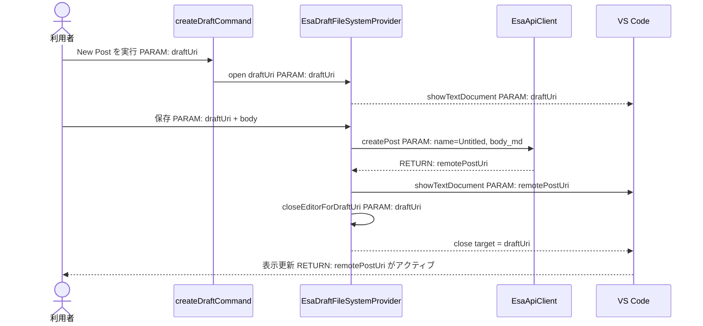
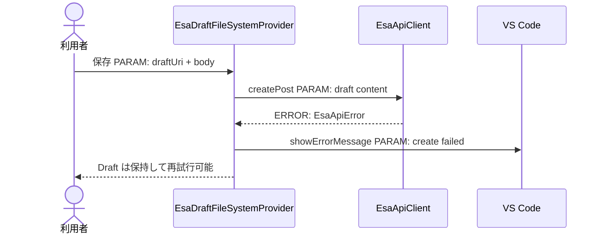
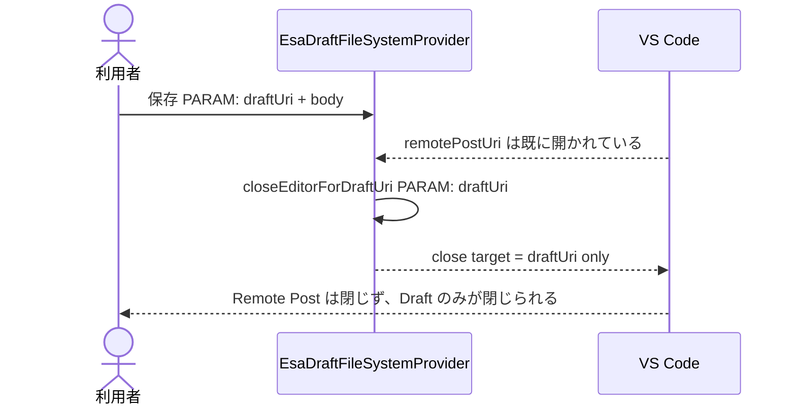
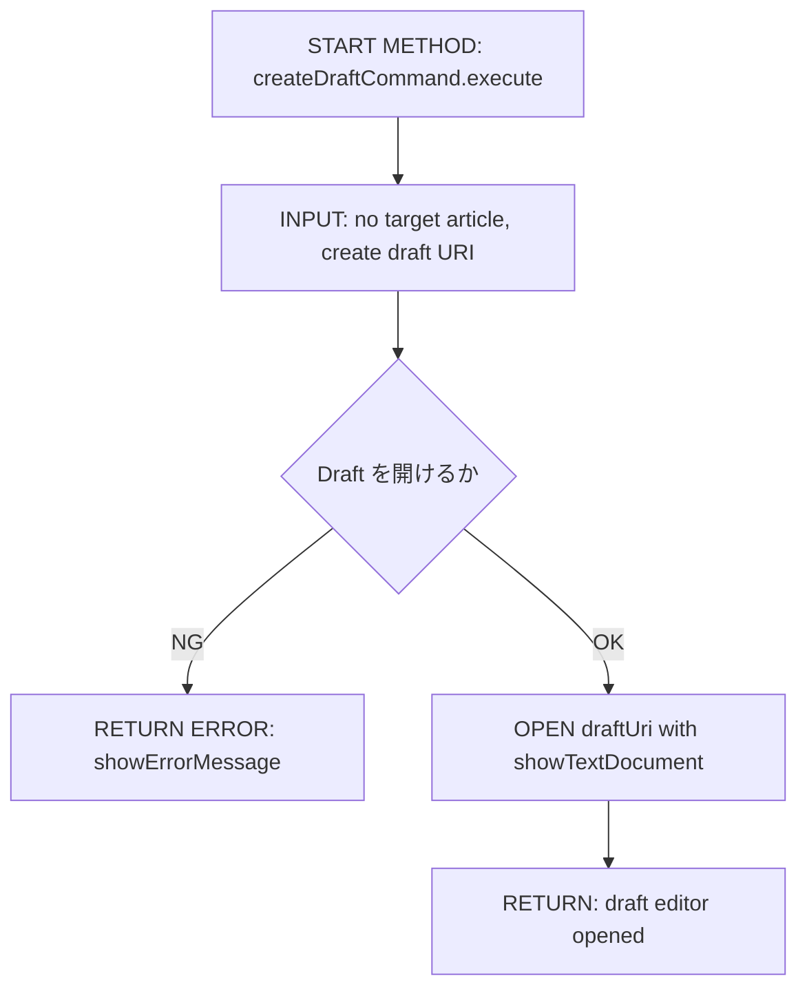
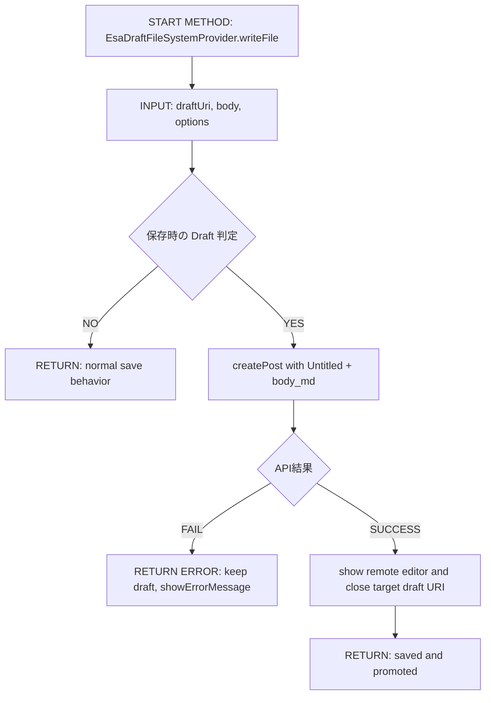
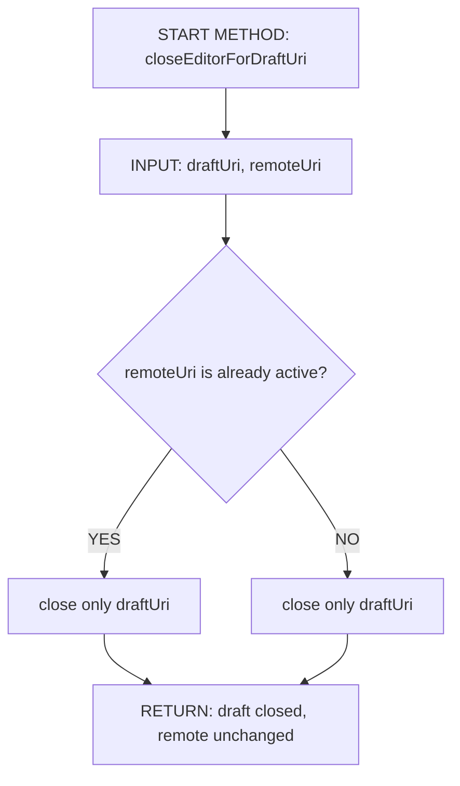

# 実装plan: 新規記事作成後の下書きエディタ閉じ忘れ修正

> 本plan は `.github/copilot/80-templates/implementation-plan.md` に準拠する。
> 対象Issue: #8 [DESIGN] 新規記事作成後に作成元の下書きエディタが閉じられない
> 実装起点: `src/filesystem/EsaDraftFileSystemProvider.ts`, `src/commands/createDraftCommand.ts`

---

## 0. 実装入力コンテキスト

| 項目 | 記入 |
| --- | --- |
| 対象Issue | #8 [DESIGN] 新規記事作成後に作成元の下書きエディタが閉じられない |
| 対象リポジトリ内パス（実装起点） | `src/filesystem/EsaDraftFileSystemProvider.ts`, `src/commands/createDraftCommand.ts` |

### 0.1 変更サマリ一覧

| 区分（追加/修正/削除） | 対象（機能/コマンド/API） | 変更概要 |
| --- | --- | --- |
| 修正 | `EsaDraftFileSystemProvider.writeFile` | 初回保存時の昇格後に、作成元の DraftURI と Remote Post URI を明示的に区別して、Draft の閉鎖対象を限定する |
| 修正 | `EsaDraftFileSystemProvider.promoteDraftToRemotePost` | `openTextDocument` / `showTextDocument` / `closeActiveEditor` の順序を見直し、アクティブエディタの取り違えを避ける |
| 修正 | `createDraftCommand.execute` | 新規 Draft の URI と最終の閉鎖対象をハンドラ側で保持し、リモート記事を誤って閉じないようにする |
| 修正 | `src/extension.ts` | `activate(context)` から注入済みの Draft Provider と関連依存を繋ぎ、閉鎖ロジックの差し替えを可能にする |
| 追加 | `src/test/filesystem/EsaDraftFileSystemProvider.test.ts` | 正常系/例外系/境界値の回帰テストを追加する |

### 0.2 入力制約一覧

| 制約区分（互換性/禁止事項/期限/その他） | 制約内容 | 適用対象 |
| --- | --- | --- |
| 互換性 | 既存の `EsaFileSystemProvider` は `create` 拒否の挙動を維持する | `src/filesystem/EsaFileSystemProvider.ts` |
| 禁止事項 | Draft を閉じる際に Remote Post の `esa://` エディタを閉じてはならない | `EsaDraftFileSystemProvider` |
| 期限 | 今回の設計は Draft の昇格後に残るタブ不具合の修正に限定する | Issue #8 |
| その他 | `showTextDocument` の後に `closeActiveEditor` を呼ぶ実装は、エディタの実際のアクティブ状態依存になりすぎるため禁止する | `EsaDraftFileSystemProvider` |

### 0.3 関連機能・関連仕様一覧

| 種別（要件/設計方針/ADR/調査/既存実装/外部仕様/その他） | パス/識別子 | この設計での利用目的 |
| --- | --- | --- |
| 要件 | `.github/copilot/10-requirements.md` | 新規記事作成時の保存後動作と受入条件を確認する |
| 設計方針 | `.github/copilot/20-architecture.md` | DI 起点と Provider / UI の責務分離を維持する |
| ADR | `.github/copilot/70-adr/ADR-006-local-draft-promotion.md` | Draft-first フローと昇格の順序を根拠とする |
| 既存実装 | `src/filesystem/EsaDraftFileSystemProvider.ts` | 根本原因の特定と修正対象の確認 |
| 既存実装 | `src/commands/createDraftCommand.ts` | 新規 Draft の生成と開く処理の起点を確認する |
| 外部仕様 | VS Code `window.showTextDocument` / `TextEditor` / `Tab` API | 閉じる対象を URI ベースで制御する手法を確定する |

---

## 1. 実装対象機能と機能ゴール

| 項目 | 内容 | 根拠 |
| --- | --- | --- |
| 実装対象詳細（機能/コマンド/View/API） | 新規記事作成の Draft 昇格後に、作成元の `esa-draft:` エディタのみを閉じる処理 | Issue #8、`EsaDraftFileSystemProvider` の昇格フロー |
| 機能ゴール（実装後に観測できるユーザーユース） | 新規記事保存後に、Draft のタブが消え、Remote Post の記事が通常の `esa://` タブとして残る | 再現条件と要望事項 |
| 非ゴール（今回やらないこと） | 記事タイトル編集、記事削除、Draft の永続化、esa API 仕様の変更 | ADR-006、Issue スコープ |
| 完了条件（実装完了の判定） | 保存後に Draft URI の閉鎖が実行され、Remote Post の Editor は閉じず、未保存変更を失わず、失敗時は Draft が残る | 要件 FR-01〜FR-05、NFR-01〜NFR-03 |
| 受入確認手順（1行で再現可能） | VS Code で「新規記事」→ `<乱数>.md` を編集して保存 → `esa://<id>.md` が開き、元の Draft タブが閉じ、リモート記事が残ることを確認する | Issue 再現手順 |

---

## 2. 前提・制約（SSOT）

| 種別 | 内容 | 根拠（ファイル/ADR/Issue） |
| --- | --- | --- |
| 参照したSSOT | `.github/copilot/00-index.md`, `.github/copilot/10-requirements.md`, `.github/copilot/20-architecture.md`, `.github/copilot/40-testing-strategy.md`, `.github/copilot/50-security.md`, `.github/copilot/60-ci-quality-gates.md`, `.github/copilot/80-templates/implementation-plan.md` | SSOT参照セット |
| アーキテクチャ前提（UI/Provider・Service/ApiClient） | UI/Provider は `extension.ts activate()` 経由で DI され、API 呼び出しは `api/` に閉じる | `.github/copilot/20-architecture.md` |
| VS Code バージョン要件 | `^1.105.0` | `package.json` |
| 技術制約（互換性/期限/運用/セキュリティ） | `EsaFileSystemProvider.writeFile` の `create` 拒否を維持し、Draft/Remote の Editor を URI で区別して閉じる | ADR-006, Issue #8 |
| 未確定前提 | なし | すべて設計判断済み |

---

## 3. 要件定義（実装受入条件）

### 3.1 機能要件

| ID | 要件 | 受入条件（テスト可能な形） |
| --- | --- | --- |
| FR-01 | 新規記事は Draft を保存したあとに Remote Post へ昇格し、Draft を閉じる | 保存直後に `esa-draft:` URI の Editor が閉じ、`esa://<id>.md` が開く |
| FR-02 | 昇格処理では `closeActiveEditor` に依存しない | メソッドが `TextEditor` / `WorkspaceEdit` のアクティブ状態ではなく、対象 URI を明示して閉じる |
| FR-03 | 閉じる対象は作成元の Draft URI に限定する | Remote Post の Editor が既に開いていても、それを閉じない |
| FR-04 | `createPost` が失敗した場合、Draft は残る | 失敗時に `showErrorMessage` 後も Draft が開いたまま残り、Remote Post は開かれない |
| FR-05 | リモート記事が既に開いている場合でも Draft の閉じ忘れが起きない | 既存の `esa://` タブがある状態でも、Draft URI の準拠により Draft のタブのみが閉じられる |
| FR-06 | 未保存変更や別エディタのフォーカスを失わない | Remote Post が次にアクティブになる場合でも、Draft の未保存本文が破棄されず、意図しないエディタが閉じられない |

### 3.2 非機能要件

| ID | 要件 | 受入条件（テスト可能な形） |
| --- | --- | --- |
| NFR-01 | Draft の閉じる判定は URI ベースで行い、アクティブエディタに依存しない | スタブ化した `window.showTextDocument` の呼び出し後でも、閉じる URI が `draftUri` であることを検証できる |
| NFR-02 | UI/Provider の責務境界を維持し、リモート記事の close フラグが UI 側で誤って適用されない | `EsaDraftFileSystemProvider` が `vscode.window` のアクティブ状態を直接閉じるのではなく、閉鎖対象 URI を管理する |
| NFR-03 | テストは `@vscode/test-cli` と Mocha によって回帰確認できる | `src/test/filesystem/EsaDraftFileSystemProvider.test.ts` に正常系/例外系/境界値のテストを追加する |
| NFR-04 | CI 品質ゲートは必ず通る | `npm run typecheck` / `npm run lint` / `npm run format:check` / `npm test` / `npm run security` が明記済み |

---

## 4. スコープ境界

### 4.0 スコープ境界の定義（機能単位）

| 区分（In-Scope/Out-of-Scope） | 対象機能/責務 | 判定理由 |
| --- | --- | --- |
| In-Scope | Draft の保存後昇格フローと閉じる対象制御 | Issue の本体であり、根本原因の修正対象 |
| In-Scope | `EsaDraftFileSystemProvider` の `closeEditorForDraftUri` への責務分離 | 経験値：閉じる対象がアクティブエディタではなく URI ベースで決定されるべき |
| In-Scope | Draft 保存失敗時の保持判定と Remote Post の未開放防止 | 例外系の受入条件を守るため |
| Out-of-Scope | 記事タイトルの Rename | 別Issueであるため |
| Out-of-Scope | Draft のセッション永続化 | 実装スコープ外 |

### 4.2 実装時の影響範囲・互換性リスク

| 影響対象 | 結論（影響あり/なし/未確定） | 影響内容 |
| --- | --- | --- |
| UI（Tree View/コマンド/QuickPick等） | 影響あり | 新規作成後に Draft を閉じる動作が、URL 指定のタブ制御へ変わる |
| API/外部通信（esa Public API v1） | 影響なし | 改修は UI/Editor 制御の順序変更に限定され、API プロトコル自体は変えない |
| データモデル（`api/types.ts`） | 影響なし | 既存の `createPost` レスポンスの型はそのまま利用する |
| 外部依存（npm） | 影響なし | 追加依存は不要 |
| CI/運用 | 影響あり | 回帰テストと CI ゲート追加が必要 |
| `package.json` contributes（commands/views/configuration） | 影響なし | コマンド名・設定項目は変わらない |

### 4.3 外部依存・Secrets の扱い

| 項目 | 内容 | リスク/対応 |
| --- | --- | --- |
| 外部依存の追加/更新（npm） | なし | 既存依存のみ使用し、追加は行わない |
| Secrets 利用有無（Personal Access Token等） | なし | 本修正は Editor 制御の順序修正であり、トークン要求や保存は変わらない |
| ログ/設定への機密混入対策 | 既存の SecretStorage とログ方針を維持する | Draft URI やタイトルのみをログ化し、トークンを含めない |

### 4.4 4章の自己検証

| チェック項目 | 合格条件 |
| --- | --- |
| Design PR 差分を書いていないか | `.github/copilot/plans/*.md` だけを対象としており、コード実装差分を含めない |
| 実装責務を書いているか | In-Scope に `EsaDraftFileSystemProvider` / `createDraftCommand` / `activate()` の責務が記載されている |
| 実装影響を書いているか | 4.2 で `影響あり` が 2 件以上あり、閉じる対象の誤動作と CI 回帰テストの影響が具体化されている |

---

## 5. アーキテクチャ設計

### 5.0 依存の組み立て（DI）経路

本プロジェクトは `src/extension.ts` の `activate(context)` を唯一のDIルートとし、`EsaDraftFileSystemProvider` と `createDraftCommand` は同一ルートから注入される。UI 層が `closeActiveEditor` を直接呼ぶのではなく、Provider 側で対象 Draft URI を管理して閉じる。

| 区分（記載例/追記No） | 提供主体 | 提供する依存 | 受け取る側 | 入力（型/値） | 出力（型/値） | 境界制約（禁止事項を含む） |
| --- | --- | --- | --- | --- | --- | --- |
| 記載例 | `extension.ts activate()` | `EsaApiClient` インスタンス | `EsaPostTreeProvider` | なし | `EsaApiClient` | Provider/コマンド内で `new EsaApiClient()` を直接呼ばない |
| 01 | `extension.ts activate()` | `EsaDraftFileSystemProvider` | `createDraftCommand` | `context`, `apiClient`, `logger` | `Disposable` | UI 層は Provider の 간접生成を利用する |
| 02 | `extension.ts activate()` | `EsaDraftFileSystemProvider` | `EsaFileSystemProvider` と並列に登録する | `vscode.workspace.registerFileSystemProvider` | `Disposable` | `closeActiveEditor` の直接呼び出しを禁止する |
| 03 | `extension.ts activate()` | `DraftCloseTargetResolver`（設計段階の責務名） | `EsaDraftFileSystemProvider` | `draftUri`, `remoteUri` | `TextDocument` / `Tab` 対象 | ルートのアクティブエディタに依存しない |

#### 5.0.1 最小固定セット

| 最小固定項目 | 必須記載内容 | 対応セクション |
| --- | --- | --- |
| DI 経路 | `activate() -> createDraftCommand / EsaDraftFileSystemProvider` を固定する | `5.0`, `5.7.0` |
| 非同期境界 | 外部 I/O と UI 更新は `async/await` によりイベントループをブロックしない | `5.5.1`, `8.3` |
| 外部I/O境界 | すべての `esa.io` API 呼び出しは `api/` 層に閉じ、閉じる動作は Editor 制御 API に限定する | `8.3`, `8.4` |

### 5.1 設計判断

#### 5.1.1 責務分離 / データフロー（詳細）

| No. | 決定事項（実装責務単位） | 根拠 | 未確定（あれば） |
| --- | --- | --- | --- |
| 1 | `createDraftCommand` は Draft の生成と `esa-draft:` URI の開放を行う | Issue 再現手順、`createDraftCommand.ts` を起点とする | なし |
| 2 | `EsaDraftFileSystemProvider` は初回保存の昇格・閉じる対象の決定・Remote Post の開放を行う | Issue 原因候補、ADR-006 | なし |
| 3 | ステップ順序は「保存→createPost→remote open→draft close」で固定する | 原因として `closeActiveEditor` が Remote を閉じる可能性があるため | なし |

#### 5.1.2 エッジケース / 例外系 / リトライ方針（詳細）

| No. | ケース | 方針（戻り値/表示/再試行） | 根拠 | 未確定（あれば） |
| --- | --- | --- | --- | --- |
| 1 | `createPost` 失敗 | Draft を保持し、`showErrorMessage` を表示して再試行可能な状態に残す | Issue/ADR-006 | なし |
| 2 | Remote Post が既に開いている | Draft の閉じる対象を `draftUri` に限定し、Remote Post は閉じない | Issue 原因候補 | なし |
| 3 | Draft の閉じ忘れが起きた場合 | `closeActiveEditor` を廃止し、URI ベースの閉じる API へ切り替える | 要件 FR-02, FR-03 | なし |

#### 5.1.3 VS Code UI部品一覧

| 種別 | 部品名（設計上の候補） | 主責務 | 対応機能 |
| --- | --- | --- | --- |
| View | Tree View `esaExplorer.posts` | 記事一覧の閲覧 | 新規記事導線の起点 |
| Command | `esaExplorer.openPost` / 新規記事コマンド | Draft の開始と既存記事の開閉 | 記事生成 |
| Input | `showQuickPick` / `InputBox` | 新規作成のカテゴリ選択や接続設定 | 既存の起点と共通化 |
| Feedback | `showErrorMessage` / `showInformationMessage` | 保存失敗や閉じる対象の制御結果 | 例外系の通知 |

#### 5.1.4 ログと観測性（漏洩防止を含む / 詳細）

| No. | 観点 | 方針 | 根拠 | 未確定（あれば） |
| --- | --- | --- | --- | --- |
| 1 | ログ出力内容 | Draft URI と Remote URI の識別、保存失敗時のエラー種別のみ記録する | `.github/copilot/50-security.md` | なし |
| 2 | マスキング/非出力項目 | Personal Access Token / 認証文字列は出力しない | `.github/copilot/50-security.md` | なし |
| 3 | エラー記録粒度 | `EsaApiError`/`showErrorMessage` を中心に、閉じる対象の URI ログを記録する | 既存の構造化ログ方針 | なし |

### 5.2 トレードオフ

| 判断テーマ | 案A | 案B | 採用案 | 採用理由 | 不採用理由 |
| --- | --- | --- | --- | --- | --- |
| 閉じる方法 | `closeActiveEditor` をそのまま使う | `draftUri` を明示して閉じる | 案B | 直前に `showTextDocument(remoteUri)` が起きると「アクティブの置き換え」で誤動作するため | 案Aは根本原因に直結する |
| 失敗時の保持 | Draft を破棄 | Draft を保持して再試行可能にする | Draft を保持 | Issue の期待値と ADR-006 に一致 | Draft 破棄は再現性が低い |

### 5.3 UI導線方針

| 項目 | 決定内容 | 根拠 |
| --- | --- | --- |
| 導線方式（Tree View項目/コマンドパレット/コンテキストメニュー/WebView） | 既存の New Post コマンドと Draft 生成の流れを引き継ぐ | `createDraftCommand.ts` |
| 操作の起点（誰がどこから呼び出すか） | 既存の New Post/保存フローから `createDraftCommand` + `EsaDraftFileSystemProvider` が発火する | Issue 再現手順 |
| `package.json` contributes への登録要否（commands/menus/views） | 登録継続、UI 変更は最小限 | 既存構成と互換性優先 |
| 状態受け渡し方式（Tree Item引数/QuickPick選択結果等） | Draft の URI と初期カテゴリをメタデータとして持ち、保存後に閉鎖判定に利用する | ADR-006 |

### 5.4 アーキテクチャレイヤー方針

| レイヤ | 定義 | 許可する依存方向 | 禁止する依存 |
| --- | --- | --- | --- |
| UI（tree/commands） | 操作受付・通知 | 注入された Provider/Service | `api/` の直接生成、`window.closeActiveEditor` の直接実行 |
| Provider/Service（filesystem） | Draft の保存と昇格・閉じる対象決定 | `api/`、`cache/`、VS Code API | コマンド登録関数に依存しない |
| ApiClient（api/） | `createPost` の呼び出し | 外部HTTP | UI/Provider層をimportしない |
| Model/Type（api/types.ts） | API応答型 | なし | 他レイヤに依存しない |

### 5.5 データ取得ライフサイクル

| データ種別 | 取得タイミング | 取得場所 | 理由 |
| --- | --- | --- | --- |
| 初期表示必須データ（記事一覧） | 既存の Tree View 更新時 | `EsaPostTreeProvider` | 既存フロー維持 |
| ユーザー操作後データ | 保存時 | `EsaDraftFileSystemProvider` | Draft→Remote昇格の対象 |
| バックグラウンド更新 | なし | なし | 本Issueは UI 制御不具合に限定 |

| キャッシュ方針 | 採用有無 | ルール |
| --- | --- | --- |
| インメモリキャッシュ（`PostCache`） | 採用 | Remote Post と Draft のマッピングをメモリで保持し、閉じる対象の誤判定を避ける |
| ディスクキャッシュ | 非採用 | 本Issueでは再起動後に保持しない |

#### 5.5.1 非同期処理とイベントループ境界

| 対象処理 | 実行コンテキスト | 実装場所 | 禁止事項 |
| --- | --- | --- | --- |
| UI更新（Tree View再描画） | Extension Host | Provider | 同期的な重い処理でイベントループをブロックしない |
| ネットワーク通信（esa.io API） | Extension Host（`async/await`） | `api/EsaApiClient.ts` | 呼び出し元をブロックする同期APIを使わない |
| ファイルI/O（`esa:` 仮想FS） | Extension Host（`async/await`） | `filesystem/EsaDraftFileSystemProvider.ts` | 非同期境界を破る同期的な閉じる処理を入れない |
| 認証情報アクセス（SecretStorage） | Extension Host（`async/await`） | `authentication/CredentialService.ts` | 直接のトークンログ出力をしない |

### 5.6 エラーハンドリング標準形

| 分類 | エラー型 | UI 表示ルール | 再試行ルール |
| --- | --- | --- | --- |
| network | `EsaApiError` | `showErrorMessage` で表示 | Draft を保持し、操作を再試行可能にする |
| unauthorized | `EsaApiError` | 認証失敗を表示 | 再認証イベントのみ維持 |
| notfound | `EsaApiError` | 記事が見つからないことを表示 | Draft remains open for recovery |
| validation | `Error` | 入力不正を表示 | Draft を保持 |
| unknown | `Error` | 原因を簡潔に表示 | Draft を保持しログに記録 |

| ログ方針 | 内容 |
| --- | --- |
| 出力する情報 | Draft URI、Remote Post URI、保存失敗の原因、エラー種別 |
| 出力しない情報（Secrets/PII） | Personal Access Token、記事本文全文、認証ヘッダー |

### 5.7 シーケンス図（Mermaid / 複数必須）

#### 5.7.0 DI 経路

| No. | 開始主体 | 終了主体 | 提供する依存 | 受け渡し方法 | 経路文字列（`A -> B -> C`） | 境界チェック観点 | 対応シーケンス図ID |
| --- | --- | --- | --- | --- | --- | --- | --- |
| 01 | `extension.ts activate()` | `createDraftCommand` | `EsaDraftFileSystemProvider` | コンストラクタ引数 | `activate() -> createDraftCommand -> draftUri open` | Provider の責務が UI から分離されている | SEQ-01 |
| 02 | `extension.ts activate()` | `EsaDraftFileSystemProvider` | `EsaApiClient` | コンストラクタ引数 | `activate() -> EsaDraftFileSystemProvider -> createPost` | `api/` に外部I/Oが閉じ込められている | SEQ-01 |

#### 5.7.1 シーケンス対象一覧

| 図ID | 種別（正常/異常） | 起点（コマンド/UI操作） | 終点（ApiClient/外部I/O） | 対応要件ID（FR/NFR） |
| --- | --- | --- | --- | --- |
| SEQ-01 | 正常 | 新規記事保存 | `createPost` / `showTextDocument` | FR-01, FR-02, FR-03 |
| SEQ-02 | 異常 | `createPost` 失敗 | `EsaApiError` | FR-04, NFR-01 |
| SEQ-03 | 境界 | 既存 Remote Post を開いている状態 | `closeEditorForDraftUri` | FR-05, NFR-02 |

#### 5.7.2 正常系シーケンス

#### 5.7.3 異常系シーケンス（業務エラー）

#### 5.7.4 異常系シーケンス（境界値）

### 5.8 処理フロー図（メソッドレベル / 複数必須）

#### 5.8.1 メソッド一覧

| 図ID | メソッド名 | 層（UI/Provider/ApiClient） | 対応要件ID（FR/NFR） |
| --- | --- | --- | --- |
| FLOW-01 | `createDraftCommand.execute` | UI/Command | FR-01 |
| FLOW-02 | `EsaDraftFileSystemProvider.writeFile` | Provider | FR-02, FR-03, FR-04 |
| FLOW-03 | `EsaDraftFileSystemProvider.closeEditorForDraftUri` | Provider | FR-03, FR-05, NFR-01 |

#### メソッドフロー（FLOW-01）

#### メソッドフロー（FLOW-02）

#### メソッドフロー（FLOW-03）

---

## 6. 契約仕様（インターフェース / 型契約）

### 6.0 契約の固定前提

| 項目 | 固定方針 |
| --- | --- |
| DI 起点 | `extension.ts activate()` のみで依存を組み立てる |
| Draft の識別 | `esa-draft:` URI を `draftUri` として扱い、`remoteUri` と分離する |
| 閉じる対象 | `closeEditorForDraftUri(draftUri)` で対象を直接指定し、アクティブエディタに依存しない |
| 例外処理 | `EsaApiError` は UI 層で `showErrorMessage` に変換し、Draft を保持する |

### 6.1 主な契約候補

| 役割 | 署名候補 | 契約内容 |
| --- | --- | --- |
| Draft の作成 | `createDraftCommand.execute()` | 新規 Draft を開く、保存後に昇格フローへ引き継ぐ |
| 保存時の昇格 | `EsaDraftFileSystemProvider.writeFile(uri, content, options)` | `draftUri` なら API POST へ遷移し、保存成功後に `draftUri` を閉じる |
| 閉じる対象の制御 | `closeEditorForDraftUri(draftUri: vscode.Uri): Promise<void>` | `draftUri` を閉じるのみで、`remoteUri` は集約しない |
| 例外通知 | `showErrorMessage(message: string): Thenable<string | undefined>` | 保存失敗時に Draft を保持してユーザーに通知 |

### 6.2 テスト設計（必須）

| 対象 | 内容 |
| --- | --- |
| 対象 | 昇格処理の閉じる対象の決定ロジック |
| 方式 | `@vscode/test-cli` による Mocha `suite` / `test` を使用 |
| ケース | 正常系: Draft の閉鎖対象が `draftUri` であること / 例外系: `createPost` 失敗時は Draft を残す / 境界値: Remote Post が既に開いている場合 |
| モック方針 | `EsaApiClient.createPost` をスタブ化し、`showTextDocument` / `closeEditorForDraftUri` を差し替える。共通ヘルパは `src/test/` に配置する |
| 検証観点 | Draft URI のみが閉じる、Remote Post の URI は閉じない、未保存変更が失われない |

### 6.3 CI品質ゲート（必須）

| チェック項目 | 実行コマンド | 目的 |
| --- | --- | --- |
| typecheck | `npm run typecheck` | TypeScript の整合性を確認 |
| lint | `npm run lint` | ESLint による静的チェック |
| format | `npm run format:check` | Prettier による整合性確認 |
| test | `npm test`（Linux/CI では `xvfb-run -a npm test`） | 回帰テストの完全実行 |
| security | `npm run security` | 依存脆弱性の確認 |

### 6.4 実装完了の判定条件

- 新規記事作成後、保存による昇格時に `draftUri` のみが閉じられる
- Remote Post の既存タブが開いていても、`remoteUri` を閉じない
- `createPost` の失敗時に Draft の本文が維持される
- `@vscode/test-cli` の回帰テストが追加され、CI ゲートが全件通る

---

## 7. 実装時の安全策

- `closeActiveEditor` はこの修正で使用しない。代わりに `vscode.window.tabGroups.close` もしくは `vscode.commands.executeCommand` の URI 指定版を使い、対象を明示的に `draftUri` にする。
- `showTextDocument` の直後に閉じる処理を行うと、リモート記事がアクティブになるたびに誤った閉鎖が起こるため、閉じる前に対象 URI を変数に保持してから、固定した URI を閉じる。
- Draft の保存時に Remote Post の本文が未保存になる場合は、開き直し後のフォーカス制御と未保存変更の継承を保証し、閉じる対象のアクティブ依存を完全に排除する。
