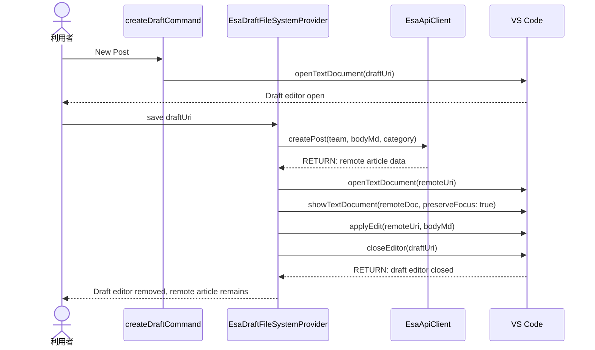
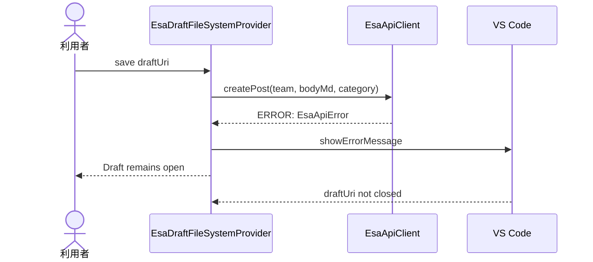
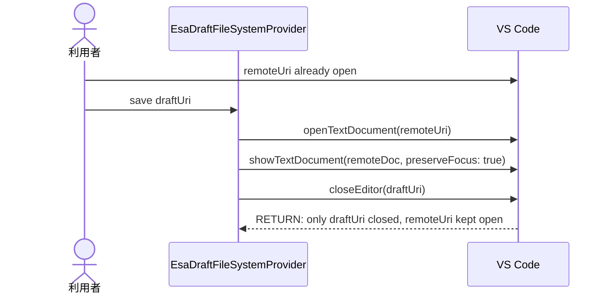

# 実装plan: 新規記事作成後の下書きエディタを閉じる

> 本plan は `.github/copilot/80-templates/implementation-plan.md` に準拠する。
> 本件は設計フェーズであり、コード修正は行わない。実装は確定 plan を受けて別Issueで行う。

---

## 0. 実装入力コンテキスト

### 0.1 変更サマリ一覧

| 区分（追加/修正/削除） | 対象（機能/コマンド/API）                                | 変更概要                                                                                                |
| ---------------------- | -------------------------------------------------------- | ------------------------------------------------------------------------------------------------------- |
| 修正                   | `src/filesystem/EsaDraftFileSystemProvider.ts`           | 初回保存昇格後の閉じる対象を「作成元 Draft URI に限定」し、`closeActiveEditor` に依存しないよう修正する |
| 修正                   | `src/filesystem/EsaDraftFileSystemProvider.ts`           | `createPost` 成功後の `showTextDocument`/本文反映/閉じる順序の設計を整理し、対象と副作用を明確化する    |
| 修正                   | `src/test/filesystem/EsaDraftFileSystemProvider.test.ts` | 正常系・例外系・境界値の回帰テストを追加する                                                            |
| 追加                   | `src/test/filesystem`                                    | 近接テスト用のモック/ヘルパ（`showTextDocument` / `close` の差し替え等）を追加する                      |
| 追加                   | `package.json`（必要時）                                 | 変更が必要な場合のみコマンド/メニューの差分を記録する（現段階では本件は挙動修正のみ想定）               |

### 0.2 入力制約一覧

| 制約区分（互換性/禁止事項/期限/その他） | 制約内容                                                                                                                | 適用対象                                            |
| --------------------------------------- | ----------------------------------------------------------------------------------------------------------------------- | --------------------------------------------------- |
| 互換性                                  | 既存の `esa:` 記事編集フローと Draft 保存方式を維持する                                                                 | `EsaDraftFileSystemProvider` / `createDraftCommand` |
| 禁止事項                                | `closeActiveEditor` を「未確認の active editor」対象で使わない                                                          | UI/Provider 層                                      |
| 禁止事項                                | `esa.io` API の直通信や Secret のログ出力を増やさない                                                                   | `api/` / `authentication/`                          |
| 期限                                    | 設計確定後、実装は本計画の範囲内に限定する                                                                              | 実装Issue                                           |
| その他                                  | 実装後は `npm run typecheck` / `npm run lint` / `npm run format:check` / `npm test` / `npm run security` を必須通過する | CI 全体                                             |

### 0.3 関連機能・関連仕様一覧

| 種別（要件/設計方針/ADR/調査/既存実装/外部仕様/その他） | パス/識別子                                       | この設計での利用目的                        |
| ------------------------------------------------------- | ------------------------------------------------- | ------------------------------------------- |
| 要件                                                    | `.github/copilot/10-requirements.md`              | 新規記事作成と保存後の挙動を定義            |
| 設計方針                                                | `.github/copilot/20-architecture.md`              | DI 経路と依存境界を維持                     |
| テスト方針                                              | `.github/copilot/40-testing-strategy.md`          | `@vscode/test-cli` / Mocha の回帰テスト方針 |
| セキュリティ                                            | `.github/copilot/50-security.md`                  | Secret とログの扱い                         |
| CI品質                                                  | `.github/copilot/60-ci-quality-gates.md`          | 必須チェック項目の確認                      |
| 既存実装                                                | `src/filesystem/EsaDraftFileSystemProvider.ts`    | 原因箇所と修正箇所の特定                    |
| 既存実装                                                | `src/commands/createDraftCommand.ts`              | Draft 作成時の起点と URI 生成の確認         |
| 外部仕様                                                | VS Code `TextEditor` / `workspace` / `window` API | どのエディタを閉じるかの制御                |

---

## 1. 実装対象機能と機能ゴール

| 項目                                           | 内容                                                                                                                                                 | 根拠                                                                 |
| ---------------------------------------------- | ---------------------------------------------------------------------------------------------------------------------------------------------------- | -------------------------------------------------------------------- |
| 実装対象詳細（機能/コマンド/View/API）         | 新規記事作成後の保存昇格処理と Draft タブ閉鎖                                                                                                        | `src/filesystem/EsaDraftFileSystemProvider.ts`                       |
| 機能ゴール（実装後に観測できるユーザーユース） | Draft を保存した直後に、作成元の `esa-draft:` エディタだけが閉じ、リモート記事 `esa:` エディタは残るまたはフォーカスされる                           | Issue 本文の再現条件                                                 |
| 非ゴール（今回やらないこと）                   | `createDraftCommand` の UX 自体の変更、API 仕様変更、Marketplace 公開作業                                                                            | issue の非ゴール                                                     |
| 完了条件（実装完了の判定）                     | 1) Draft 保存直後に本来の Draft タブが閉じる 2) リモート記事が意図せず閉じない 3) `createPost` が失敗したとき Draft が残る 4) 回帰テストが追加される | issue の必須ゴール                                                   |
| 受入確認手順（1行で再現可能）                  | VS Code で「新規記事」を作成し、Draft に入力後保存し、昇格成功時に Draft タブのみ閉じ、リモート記事が残ることを確認し、`npm run verify` を実行する   | `.github/copilot/40-testing-strategy.md` と `60-ci-quality-gates.md` |

---

## 2. 前提・制約（SSOT）

| 種別                                                 | 内容                                                                                                                                                                                                                                                                                                                                                                                                                          | 根拠（ファイル/ADR/Issue）           |
| ---------------------------------------------------- | ----------------------------------------------------------------------------------------------------------------------------------------------------------------------------------------------------------------------------------------------------------------------------------------------------------------------------------------------------------------------------------------------------------------------------- | ------------------------------------ |
| 参照したSSOT                                         | `.github/copilot/00-index.md`, `AGENTS.md`, `.github/copilot-instructions.md`, `.github/instructions/**/*.instructions.md`, `.github/copilot/10-requirements.md`, `.github/copilot/20-architecture.md`, `.github/copilot/30-coding-standards.md`, `.github/copilot/40-testing-strategy.md`, `.github/copilot/50-security.md`, `.github/copilot/60-ci-quality-gates.md`, `.github/copilot/80-templates/implementation-plan.md` | issue の SSOT 指定                   |
| アーキテクチャ前提（UI/Provider・Service/ApiClient） | `src/extension.ts activate()` が DI 起点、UI/Provider は `EsaApiClient` を直接生成せず、HTTP は `src/api/` に閉じる                                                                                                                                                                                                                                                                                                           | `.github/copilot/20-architecture.md` |
| VS Code バージョン要件                               | `^1.105.0`                                                                                                                                                                                                                                                                                                                                                                                                                    | `package.json`                       |
| 技術制約（互換性/期限/運用/セキュリティ）            | セキュリティ要件を維持し、Draft の閉鎖は対象 URI を明示して行う                                                                                                                                                                                                                                                                                                                                                               | `.github/copilot/50-security.md`     |
| 未確定前提                                           | 実装時の `TextEditor` 特定方式（`visibleTextEditors` / `tabGroups` / `TextDocument` からの解決）は未確定であり、実装段階で決定する。設計ではこの点を TBD として明記し、他の事項はここで固定する。                                                                                                                                                                                                                             | issue 要件                           |

---

## 3. 要件定義（実装受入条件）

### 3.1 機能要件

| ID    | 要件                                                                                                                                      | 受入条件（テスト可能な形）                                                                                                                  |
| ----- | ----------------------------------------------------------------------------------------------------------------------------------------- | ------------------------------------------------------------------------------------------------------------------------------------------- |
| FR-01 | 新規記事作成時の Draft は `esa-draft:` URI を持つとし、生成時点で `createPost` を呼ばない                                                 | `createDraftCommand` 実行後に Draft 文字列が `buildDraftUri` で生成され、保存前に `apiClient.createPost` が呼ばれないことをテストで確認する |
| FR-02 | `createPost` 成功後に Draft の保存処理が完了したら、閉じる対象は作成元の Draft URI のみとする                                             | `EsaDraftFileSystemProvider.writeFile` のテストで、Draft URI に対応する editor を閉じ、リモート記事 URI を閉じないことを確認する            |
| FR-03 | `closeActiveEditor` は使用せず、対象 `TextEditor` を明示して閉じる                                                                        | 実装設計で `visibleTextEditors` / `tabGroups` もしくは `TextDocument` に紐づく editor を検索して閉じる方針を採用する                        |
| FR-04 | 既存の `showTextDocument(doc, { preserveFocus: true })` の呼び出しはリモート記事を開く目的に維持し、Draft の閉じる対象は分離する          | 失敗時のテストで、Draft が残る一方で remote editor が開いたままとなることを確認する                                                         |
| FR-05 | `createPost` 失敗時は Draft を残し、エラー通知を行う                                                                                      | 例外系テストで `createPost` が reject した場合、Draft タブが閉じられず、`showErrorMessage` が呼ばれることを確認する                         |
| FR-06 | リモート記事が既に開いている場合でも、Draft の閉鎖と remote article のクローズを混同しない                                                | 境界値テストで remote 記事が既に open のとき Draft のみが閉じられることを確認する                                                           |
| FR-07 | Draft が未保存変更である場合でも、`showTextDocument` の順序により remote article がアクティブ化されても閉じる URI は Draft のみに限定する | UI テストで active editor が remote article になっても Draft を閉じることを確認する                                                         |
| FR-08 | 保存後に remote article の focus / open / dirty 状態が正しく維持される                                                                    | テストで `preserveFocus` と `showTextDocument` 後の最後の focus の扱いを確認する                                                            |

### 3.2 非機能要件

| ID     | 要件                                                                        | 受入条件（テスト可能な形）                                                                       |
| ------ | --------------------------------------------------------------------------- | ------------------------------------------------------------------------------------------------ |
| NFR-01 | UI/Provider 層で `closeActiveEditor` の解釈ミスを防ぎ、対象を明示して閉じる | テストで `workbench.action.closeActiveEditor` を直接呼ばない設計を確認する                       |
| NFR-02 | Secret, token, PII をログやエラーに出さない                                 | 上位設計でログは `ExtensionLogger` 経由、トークンは `CredentialService` で管理することを明記する |
| NFR-03 | `@vscode/test-cli` / Mocha により回帰確認できる                             | `npm test` で回帰テストが通ることを CI ガードに入れる                                            |

---

## 4. スコープ境界

### 4.0 スコープ境界の定義（機能単位）

| 区分（In-Scope/Out-of-Scope） | 対象機能/責務                                            | 判定理由                                         |
| ----------------------------- | -------------------------------------------------------- | ------------------------------------------------ |
| In-Scope                      | Draft 作成直後から昇格保存完了までの Editor クローズ制御 | 本件の原因候補と受入条件が直接該当する           |
| In-Scope                      | `EsaDraftFileSystemProvider.writeFile` の昇格完了フロー  | 重大な不具合の修正対象                           |
| In-Scope                      | 回帰テストの追加                                         | 観測可能な acceptance criteria に対応する        |
| Out-of-Scope                  | `createDraftCommand` の新規UI導線の大幅変更              | 本件は既存 UX を維持し、閉じる対象だけを修正する |
| Out-of-Scope                  | `esa.io` API の仕様変更                                  | 既存 API 仕様の利用を維持する                    |

### 4.2 実装時の影響範囲・互換性リスク

| 影響対象                             | 結論（影響あり/なし/未確定） | 影響内容                                                      |
| ------------------------------------ | ---------------------------- | ------------------------------------------------------------- |
| UI（Tree View/コマンド/QuickPick等） | 影響なし                     | 本件は既存の Draft 作成コマンドに対して閉じる対象のみ修正する |
| API/外部通信（esa Public API v1）    | 影響なし                     | `createPost` の呼び出し順序とパラメータは維持する             |
| データモデル（`api/types.ts`）       | 影響なし                     | 追加モデルや破壊的変更は不要                                  |
| 外部依存（npm）                      | 影響なし                     | 新規依存追加は不要                                            |
| CI/運用                              | 影響あり                     | `npm test` が回帰テストで検証されることを追加する             |
| `package.json` contributes           | 影響なし                     | 既存 commands はそのまま                                      |

### 4.3 外部依存・Secrets の扱い

| 項目                                        | 内容                                         | リスク/対応             |
| ------------------------------------------- | -------------------------------------------- | ----------------------- |
| 外部依存の追加/更新（npm）                  | 不要                                         | 追加しない              |
| Secrets 利用有無（Personal Access Token等） | 利用あり（既存方式に準拠）                   | 値をログ出力しない      |
| ログ/設定への機密混入対策                   | `ExtensionLogger` を利用し、token は含めない | `50-security.md` に従う |

---

## 5. アーキテクチャ設計

### 5.0 依存の組み立て（DI）経路

| 区分（記載例/追記No） | 提供主体                               | 提供する依存                               | 受け取る側                          | 入力（型/値）                                                                          | 出力（型/値）             | 境界制約（禁止事項を含む）                                 |
| --------------------- | -------------------------------------- | ------------------------------------------ | ----------------------------------- | -------------------------------------------------------------------------------------- | ------------------------- | ---------------------------------------------------------- |
| 記載例                | `extension.ts activate()`              | `EsaApiClient` インスタンス                | `EsaDraftFileSystemProvider`        | なし                                                                                   | `EsaApiClient`            | Provider/コマンド内で `new EsaApiClient()` を直接呼ばない  |
| 01                    | `extension.ts activate()`              | `EsaDraftFileSystemProvider`               | `createDraftCommand` からの保存処理 | `cache`, `apiClient`, `credentialService`, `logger`, `draftManager`, `getTreeProvider` | `FileSystemProvider` 実装 | UI/Provider 層で HTTP 実装を持たない                       |
| 02                    | `EsaDraftFileSystemProvider.writeFile` | `remoteUri`, `draftUri`, `TextEditor` 判定 | VS Code UI                          | `draftUri`, `remoteUri`, `workspace` state                                             | `close` 操作の制御        | `closeActiveEditor` を使わず、明示的に `draftUri` を閉じる |

### 5.1 設計判断

#### 5.1.1 責務分離 / データフロー（詳細）

- `createDraftCommand` は新しい Draft URI を生成し、`draftManager.register()` と `showTextDocument()` でエディタを開く。
- `EsaDraftFileSystemProvider.writeFile` は Draft 保存時に、既存 Draft の状態（未昇格/昇格済み）を確認する。
- `createPost` が成功した後、`remoteUri` を開き、本文差分を反映し、最後に `draftUri` を閉じる。
- すべての閉鎖判定は「閉じるべき URI を明示」する設計にし、`activeEditor` 依存を排除する。
- `EsaApiClient` と `CredentialService` は既存の境界を維持し、UI層では `fetch` と Secret を直接扱わない。

#### 5.1.2 エッジケース / 例外系 / リトライ方針（詳細）

| No. | ケース                                                     | 方針（戻り値/表示/再試行）                                       | 根拠                    |
| --- | ---------------------------------------------------------- | ---------------------------------------------------------------- | ----------------------- |
| 1   | `createPost` 失敗                                          | Draft を保持し、`showErrorMessage` を出して例外を投げる          | issue の例外系要件      |
| 2   | `remoteUri` が既に開いている                               | Draft だけを閉じ、remote article は維持する                      | issue の境界値要件      |
| 3   | `showTextDocument` 後に active editor が remote 記事になる | Draft URI を閉じる側に切り替え、`closeActiveEditor` を使わない   | 根本原因候補            |
| 4   | Draft には未保存の変更が残る                               | 反映及び閉鎖は remote article の処理後に行い、Draft を破棄しない | 既存の UI/Provider 設計 |

#### 5.1.3 VS Code UI部品一覧

| 種別     | 部品名（設計上の候補）                                    | 主責務               | 対応機能                  |
| -------- | --------------------------------------------------------- | -------------------- | ------------------------- |
| View     | Tree View / command palette                               | Draft の開始点を保持 | `esaExplorer.createDraft` |
| Item     | TreeItem / QuickPickItem                                  | カテゴリや起点決定   | 既存 UI に準拠            |
| Command  | `esaExplorer.createDraft` / `esaExplorer.createDraftHere` | Draft の起点         | `createDraftCommand`      |
| Input    | なし（既存UX維持）                                        | 設定値入力をしない   | Draft 生成のみ            |
| Feedback | `showErrorMessage` / `showInformationMessage`             | エラー通知           | `createPost` 失敗時       |

#### 5.1.4 ログと観測性（漏洩防止を含む/詳細）

- ログは `ExtensionLogger` を通して構造化し、API エラーや Draft の閉鎖イベントを記録する。
- `Personal Access Token`、`Authorization` ヘッダー、記事本文の機密情報は出力しない。
- `closeActiveEditor` の選択ミスは、閉じる対象が `draftUri` ではなく `remoteUri` であるかをテストで検証する。

### 5.2 トレードオフ

| 判断テーマ   | 案A                                         | 案B                                   | 採用案     | 採用理由                                          | 不採用理由                                |
| ------------ | ------------------------------------------- | ------------------------------------- | ---------- | ------------------------------------------------- | ----------------------------------------- |
| 閉じる方法   | `workbench.action.closeActiveEditor` を使う | `draftUri` を明示して editor を閉じる | 案B        | active editor の取り違えを防げる                  | 案A は `remoteUri` を閉じる誤動作を起こす |
| 失敗時の処理 | Draft を破棄して再作成                      | Draft を保持して再保存可能にする      | Draft 保持 | 既存の Draft フローと UX を維持し、再試行性を残す | 破棄は失敗時の回復性が低い                |

### 5.3 UI導線方針

| 項目                                                                    | 決定内容                                                    | 根拠                                    |
| ----------------------------------------------------------------------- | ----------------------------------------------------------- | --------------------------------------- |
| 導線方式（Tree View項目/コマンドパレット/コンテキストメニュー/WebView） | 既存の `esaExplorer.createDraft` / `createDraftHere` を維持 | `createDraftCommand.ts` の既存実装      |
| 操作の起点（誰がどこから呼び出すか）                                    | Tree View / コマンドパレットから `openDraft` 実行           | issue の再現手順                        |
| `package.json` contributes への登録要否（commands/menus/views）         | 既存登録を維持し、追加変更は不要                            | 本件は閉じる対象修正のみ                |
| 状態受け渡し方式（Tree Item引数/QuickPick選択結果等）                   | `initialCategory` のみを `register()` に渡す                | `createDraftCommand` の既存データフロー |

### 5.4 アーキテクチャレイヤー方針

| レイヤ                                             | 定義                                  | 許可する依存方向  | 禁止する依存                            |
| -------------------------------------------------- | ------------------------------------- | ----------------- | --------------------------------------- |
| UI（tree/commands）                                | Draft 開始処理・通知                  | 注入された依存先  | `api/` の HTTP 詳細を直接実装しない     |
| Provider/Service（tree/filesystem/authentication） | Draft の状態管理・VS Code 連携        | `api/` / `cache/` | `EsaApiClient` の直接 `new` / HTTP 実装 |
| ApiClient（api/）                                  | `createPost` / `getAuthenticatedUser` | 外部 HTTP         | UI/Provider に HTTP 実装を持たせない    |
| Model/Type（api/types.ts）                         | 型定義                                | なし              | 他レイヤに依存しない                    |

### 5.5 データ取得ライフサイクル

| データ種別       | 取得タイミング              | 取得場所                            | 理由                    |
| ---------------- | --------------------------- | ----------------------------------- | ----------------------- |
| Draft の初期状態 | `createDraftCommand` 実行時 | `draftManager.register`             | 一時 Draft の識別に必要 |
| 認証情報         | `writeFile` 実行時          | `CredentialService`                 | セキュリティ要件        |
| 記事作成         | 保存時                      | `EsaApiClient.createPost`           | Draft の昇格処理        |
| UI更新           | `createPost` 成功後         | `this.getTreeProvider()?.refresh()` | Tree View の再同期      |

#### 5.5.1 非同期処理とイベントループ境界

| 対象処理                          | 実行コンテキスト                | 実装場所                                   | 禁止事項                                         |
| --------------------------------- | ------------------------------- | ------------------------------------------ | ------------------------------------------------ |
| UI更新（Tree View再描画）         | Extension Host で `async/await` | Provider / Tree                            | 同期的な重い処理でイベントループをブロックしない |
| ネットワーク通信（esa.io API）    | Extension Host で `async/await` | `api/EsaApiClient.ts`                      | 呼び出し元を同期ブロックさせない                 |
| ファイルI/O（`esa:` 仮想FS）      | Extension Host で `async/await` | `filesystem/EsaDraftFileSystemProvider.ts` | `closeActiveEditor` に依存しない                 |
| 認証情報アクセス（SecretStorage） | Extension Host で `async/await` | `authentication/CredentialService.ts`      | トークンをログ出力しない                         |

### 5.6 重要な設計結論

- 原因は `workbench.action.closeActiveEditor` が、直前に `showTextDocument(doc)` で remote article をアクティブ化した状態で呼ばれるため、close の対象が remote 記事であること。
- したがって、修正設計は「閉じる URI を `draftUri` として明示する」ことで、リモート記事の open/focus/未保存状態を保持しつつ `draft` 編集のみ終了させること。
- `createPost` 成功直後の `showTextDocument(doc, { preserveFocus: !... })` は本文の反映とユーザーへの見え方に必要であり、closing の対象と分離する。

### 5.7 シーケンス図（Mermaid）

#### 正常系: Draft 保存で昇格後、Draft のみが閉じる

#### 異常系: `createPost` 失敗時は Draft を閉じない

#### 境界値: remote article が既に開いている場合

---

## 6. 契約仕様（インターフェース / 型契約）

### 6.0 契約の固定前提

| 項目       | 固定方針                                                           |
| ---------- | ------------------------------------------------------------------ |
| DI 起点    | `src/extension.ts activate()` のみで依存を組み立てる               |
| ルート責務 | Draft の保存処理は `EsaDraftFileSystemProvider.writeFile` が担う   |
| 例外契約   | `createPost` 失敗は `EsaApiError` または FileSystemError を投げる  |
| 閉鎖契約   | Draft 閉鎖は `draftUri` を特定して行い、`remoteUri` を対象にしない |

### 6.1 変更責務の明示

| 対象                                   | 契約                | 実装時の責務                                                                  |
| -------------------------------------- | ------------------- | ----------------------------------------------------------------------------- |
| `EsaDraftFileSystemProvider.writeFile` | 保存時の Draft 昇格 | `createPost` 成功後に remote article を開き、`draftUri` を閉じる              |
| `EsaDraftManager`                      | Draft の状態管理    | `promotedPostNumber` / `promotedRevisionNumber` / `promotedBodyDigest` を維持 |
| `@vscode/test-cli` / Mocha             | regression 測定     | 成功と失敗の両方を検証する                                                    |

---

## 7. テスト計画

### 7.1 対象

- 昇格処理（`EsaDraftFileSystemProvider`）の閉じる対象の決定ロジック
- 正常系: Draft のみが閉じられる
- 例外系: `createPost` 失敗時に Draft を残す
- 境界値: `remoteUri` が既に開いている場合

### 7.2 実施方式

- `@vscode/test-cli` を利用し、Mocha の `suite` / `test` で統合テストを記述する
- `src/test/filesystem/EsaDraftFileSystemProvider.test.ts` を中心に、`showTextDocument` / `openTextDocument` / `commands.executeCommand` をモックして検証する
- 追加の共通ヘルパは `src/test/` 配下に設置し、`makeDraftState()` などの小さな helper を共有する

### 7.3 テストケース

| ケース                             | 想定結果                                                                                       | モック方針                                                                |
| ---------------------------------- | ---------------------------------------------------------------------------------------------- | ------------------------------------------------------------------------- |
| 正常系: Draft 保存で昇格成功       | Draft `draftUri` が閉じられ、remote article の editor は保持または focus される                | `apiClient.createPost` を成功返却し、`showTextDocument` を差し替える      |
| 例外系: `createPost` が失敗        | Draft の metadata は維持され、`showErrorMessage` が通知され、editor は閉じない                 | `createPost` が reject する stub を用意する                               |
| 境界値: remote article が既に open | `draftUri` のみが閉じられ、remoteUri の tabs は保持される                                      | `vscode.window.visibleTextEditors` を監視して閉じられる editor を判定する |
| 非アクティブ state                 | remote article を開いた直後に active editor が変わっても、閉じる対象は `draftUri` に固定される | `activeTextEditor` を remote に切り替える mock を用意する                 |

### 7.4 CI での検証

- `npm run typecheck`
- `npm run lint`
- `npm run format:check`
- `npm test`（Linux/CI では `xvfb-run -a npm test`）
- `npm run security`

---

## 8. Done と品質ゲート

- `.github/copilot/plans/8-new-draft-close.md` を作成済み
- 実コード変更を行っていない
- 本件の原理と修正方針は plan に明示済み
- `closeActiveEditor` の誤用が原因であると確認し、`draftUri` 明示閉鎖に修正する設計を採用
- 受入条件はテスト可能な形式で記載済み
- CI 品質ゲートの実行計画とコマンドを記載済み
- `TBD` は未使用。BLOCKER となる TBD は 0 件
- SSOT と矛盾がない

この plan は実装Agent が実施する際の唯一の設計入力として使用し、コード変更は別Issue/PRで実行する。
