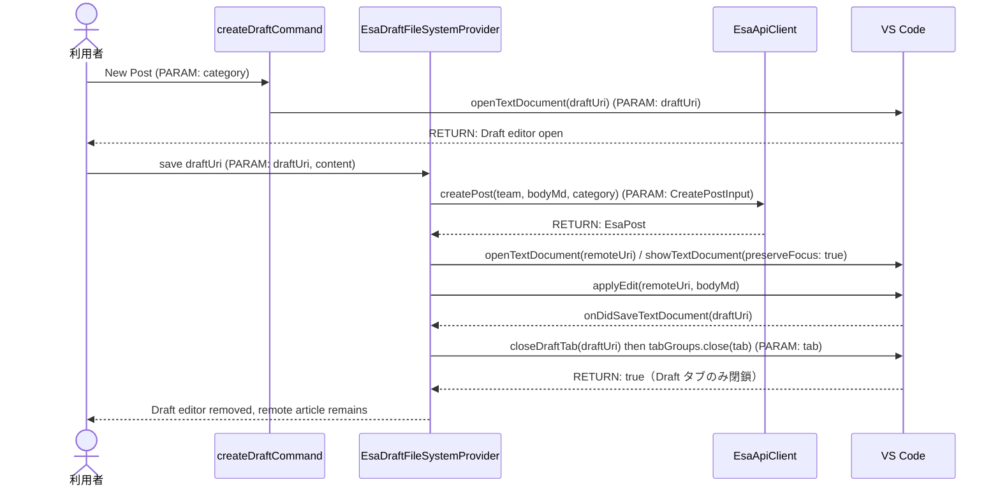
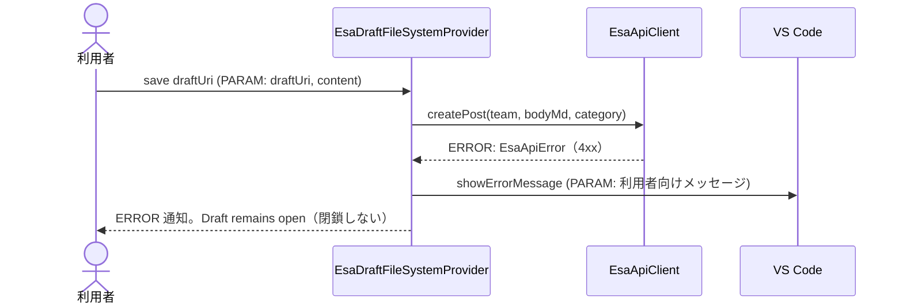
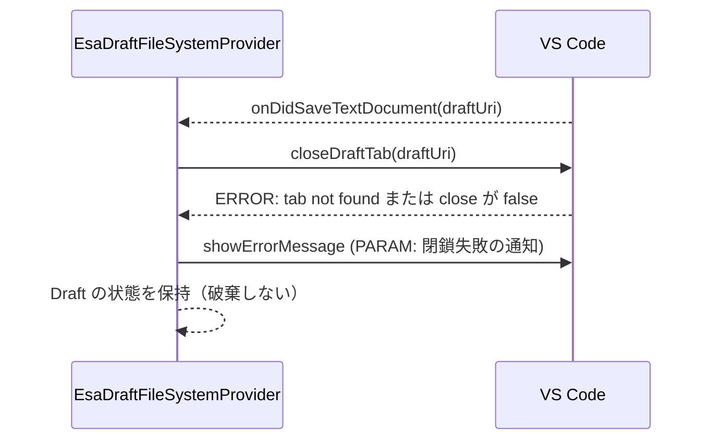
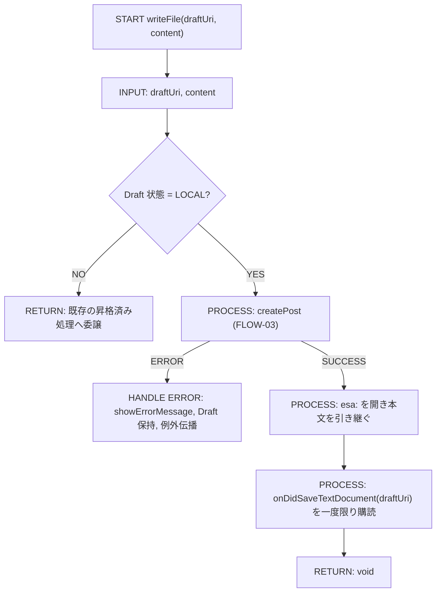
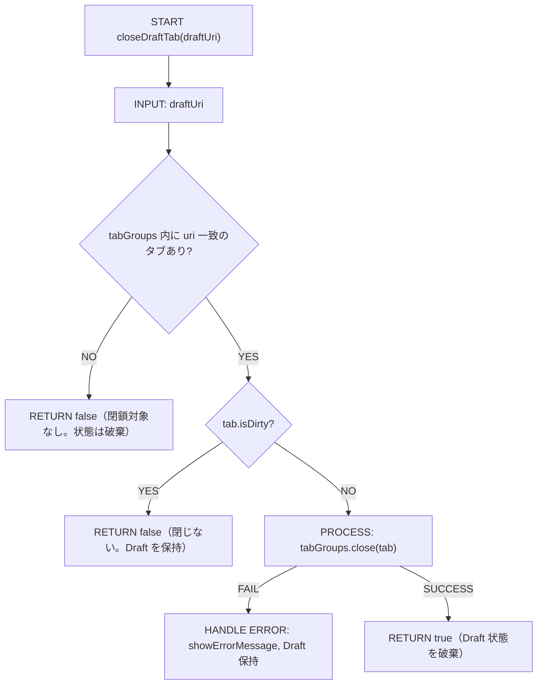
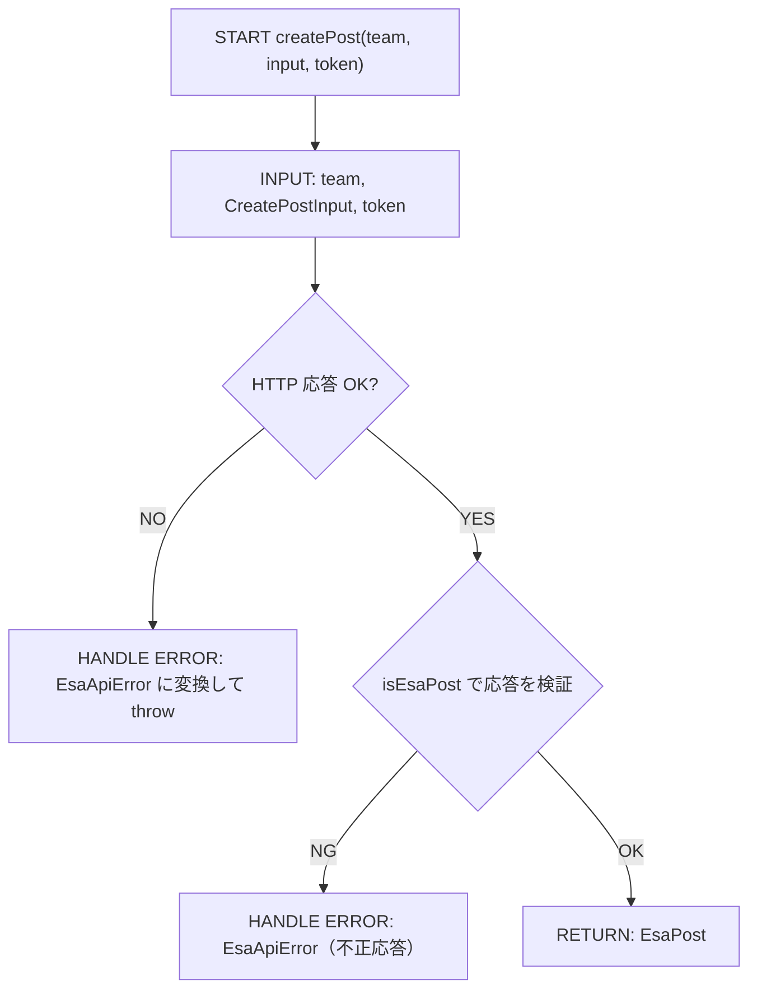

# 実装plan: 新規記事作成後の下書きエディタを閉じる

> 本plan は `.github/copilot/80-templates/implementation-plan.md` に準拠する。
> 本件は設計フェーズであり、コード修正は行わない。実装は確定 plan を受けて別Issueで行う。

---

## 0. 実装入力コンテキスト

### 0.1 変更サマリ一覧

| 区分（追加/修正/削除） | 対象（機能/コマンド/API）                                | 変更概要                                                                                                                                          |
| ---------------------- | -------------------------------------------------------- | ------------------------------------------------------------------------------------------------------------------------------------------------- |
| 修正                   | `src/filesystem/EsaDraftFileSystemProvider.ts`           | 昇格後の閉鎖を `closeActiveEditor` から外し、`vscode.window.tabGroups` で作成元 Draft URI のタブだけを特定して閉じる private メソッドへ置き換える |
| 修正                   | `src/filesystem/EsaDraftFileSystemProvider.ts`           | `createPost` 成功後の順序（remote 表示・本文引継ぎ・Draft 閉鎖）を整理し、Draft 閉鎖は保存完了後に行う                                            |
| 修正                   | `src/test/filesystem/EsaDraftFileSystemProvider.test.ts` | 正常系・例外系・境界値の回帰テストを追加する                                                                                                      |
| 追加                   | `src/test/filesystem`                                    | 近接テスト用のモック/ヘルパ（`tabGroups` / `showTextDocument` / `onDidSaveTextDocument` の差し替え等）を追加する                                  |
| 変更なし               | `package.json`                                           | コマンド・メニュー・activationEvents は変更しない（挙動修正のみ）                                                                                 |

### 0.2 入力制約一覧

| 制約区分（互換性/禁止事項/期限/その他） | 制約内容                                                                                                                | 適用対象                                            |
| --------------------------------------- | ----------------------------------------------------------------------------------------------------------------------- | --------------------------------------------------- |
| 互換性                                  | 既存の `esa:` 記事編集フローと Draft 保存方式を維持する                                                                 | `EsaDraftFileSystemProvider` / `createDraftCommand` |
| 禁止事項                                | `workbench.action.closeActiveEditor` を使わない（active editor を閉鎖対象の根拠にしない）                               | UI/Provider 層                                      |
| 禁止事項                                | `esa.io` API の直通信や Secret のログ出力を増やさない                                                                   | `api/` / `authentication/`                          |
| 期限                                    | 設計確定後、実装は本計画の範囲内に限定する                                                                              | 実装Issue                                           |
| その他                                  | 実装後は `npm run typecheck` / `npm run lint` / `npm run format:check` / `npm test` / `npm run security` を必須通過する | CI 全体                                             |

### 0.3 関連機能・関連仕様一覧

| 種別（要件/設計方針/ADR/調査/既存実装/外部仕様/その他） | パス/識別子                                                                     | この設計での利用目的                                   |
| ------------------------------------------------------- | ------------------------------------------------------------------------------- | ------------------------------------------------------ |
| 要件                                                    | `.github/copilot/10-requirements.md`                                            | 新規記事作成と保存後の挙動を定義                       |
| 設計方針                                                | `.github/copilot/20-architecture.md`                                            | DI 経路と依存境界を維持                                |
| テスト方針                                              | `.github/copilot/40-testing-strategy.md`                                        | `@vscode/test-cli` / Mocha の回帰テスト方針            |
| セキュリティ                                            | `.github/copilot/50-security.md`                                                | Secret とログの扱い                                    |
| CI品質                                                  | `.github/copilot/60-ci-quality-gates.md`                                        | 必須チェック項目の確認                                 |
| ADR                                                     | `.github/copilot/70-adr/ADR-006-local-draft-promotion.md`                       | ローカル Draft と昇格モデル（Issue #6 / PR #7 の前提） |
| 既存実装                                                | `src/filesystem/EsaDraftFileSystemProvider.ts`                                  | 原因箇所（閉鎖処理）と修正箇所の特定                   |
| 既存実装                                                | `src/commands/createDraftCommand.ts`                                            | Draft 作成時の起点と URI 生成の確認                    |
| 既存実装                                                | `src/filesystem/EsaDraftUri.ts`                                                 | `buildDraftUri` / `parseDraftUri` による URI 照合      |
| 外部仕様                                                | VS Code `window.tabGroups` / `TabInputText` / `workspace.onDidSaveTextDocument` | Draft タブの特定と閉鎖、保存完了の待ち合わせ           |

---

## 1. 実装対象機能と機能ゴール

| 項目                                           | 内容                                                                                                                                                 | 根拠                                                                 |
| ---------------------------------------------- | ---------------------------------------------------------------------------------------------------------------------------------------------------- | -------------------------------------------------------------------- |
| 実装対象詳細（機能/コマンド/View/API）         | 新規記事作成後の保存昇格処理と Draft タブ閉鎖                                                                                                        | `src/filesystem/EsaDraftFileSystemProvider.ts`                       |
| 機能ゴール（実装後に観測できるユーザーユース） | Draft を保存した直後に、作成元の `esa-draft:` エディタだけが閉じ、リモート記事 `esa:` エディタは残るまたはフォーカスされる                           | Issue 本文の再現条件                                                 |
| 非ゴール（今回やらないこと）                   | `createDraftCommand` の UX 自体の変更、API 仕様変更、Marketplace 公開作業、Issue #11 の再保存・サイドバー更新の不具合                                | issue の非ゴール                                                     |
| 完了条件（実装完了の判定）                     | 1) Draft 保存直後に本来の Draft タブが閉じる 2) リモート記事が意図せず閉じない 3) `createPost` が失敗したとき Draft が残る 4) 回帰テストが追加される | issue の必須ゴール                                                   |
| 受入確認手順（1行で再現可能）                  | VS Code で「新規記事」を作成し、Draft に入力後保存し、昇格成功時に Draft タブのみ閉じ、リモート記事が残ることを確認し、`npm run verify` を実行する   | `.github/copilot/40-testing-strategy.md` と `60-ci-quality-gates.md` |

---

## 2. 前提・制約（SSOT）

| 種別                                                 | 内容                                                                                                                                                                                                                                                                                                                                                                                                                          | 根拠（ファイル/ADR/Issue）           |
| ---------------------------------------------------- | ----------------------------------------------------------------------------------------------------------------------------------------------------------------------------------------------------------------------------------------------------------------------------------------------------------------------------------------------------------------------------------------------------------------------------- | ------------------------------------ |
| 参照したSSOT                                         | `.github/copilot/00-index.md`, `AGENTS.md`, `.github/copilot-instructions.md`, `.github/instructions/**/*.instructions.md`, `.github/copilot/10-requirements.md`, `.github/copilot/20-architecture.md`, `.github/copilot/30-coding-standards.md`, `.github/copilot/40-testing-strategy.md`, `.github/copilot/50-security.md`, `.github/copilot/60-ci-quality-gates.md`, `.github/copilot/80-templates/implementation-plan.md` | issue の SSOT 指定                   |
| アーキテクチャ前提（UI/Provider・Service/ApiClient） | `src/extension.ts activate()` が DI 起点、UI/Provider は `EsaApiClient` を直接生成せず、HTTP は `src/api/` に閉じる                                                                                                                                                                                                                                                                                                           | `.github/copilot/20-architecture.md` |
| VS Code バージョン要件                               | `^1.105.0`（`tabGroups` API は 1.67 以降で利用可能）                                                                                                                                                                                                                                                                                                                                                                          | `package.json`                       |
| 技術制約（互換性/期限/運用/セキュリティ）            | セキュリティ要件を維持し、Draft の閉鎖は対象 URI を照合して行う（active editor を使わない）                                                                                                                                                                                                                                                                                                                                   | `.github/copilot/50-security.md`     |
| 閉鎖条件の SSOT                                      | Draft の閉鎖条件（保存完了後・未保存変更なし・対象タブのみ）は Issue #6 の §8.3 に従う                                                                                                                                                                                                                                                                                                                                        | Issue #6 / ADR-006                   |

---

## 3. 要件定義（実装受入条件）

### 3.1 機能要件

| ID    | 要件                                                                                                                             | 受入条件（テスト可能な形）                                                                                                                                                |
| ----- | -------------------------------------------------------------------------------------------------------------------------------- | ------------------------------------------------------------------------------------------------------------------------------------------------------------------------- |
| FR-01 | 新規記事作成時の Draft は `esa-draft:` URI を持つ。生成時点で `createPost` を呼ばない                                            | `createDraftCommand` 実行後に `buildDraftUri` で生成された URI が開かれ、保存前に `apiClient.createPost` が呼ばれないことをテストで確認する                               |
| FR-02 | `createPost` 成功後、Draft の保存が完了したら閉じる対象は作成元 Draft URI のタブのみとする                                       | 正常系テストで、`tabGroups` 内の `TabInputText.uri` が Draft URI と一致するタブのみ `tabGroups.close` の対象になり、リモート記事 URI のタブは対象にならないことを確認する |
| FR-03 | 閉鎖は `workbench.action.closeActiveEditor` を使わず、`vscode.window.tabGroups` で URI 照合したタブを `tabGroups.close` で閉じる | テストで `closeActiveEditor` が呼ばれないこと、閉じた対象が URI 照合の結果と一致することを確認する                                                                        |
| FR-04 | Draft の閉鎖は保存完了イベント（`onDidSaveTextDocument` で Draft URI に一致する一度限りの購読）の後に行う                        | テストで、保存完了イベントの発火前に `tabGroups.close` が呼ばれないこと、発火後に呼ばれることを確認する                                                                   |
| FR-05 | 閉鎖時点で Draft が未保存変更（dirty）の場合は閉じず、Draft を保持する                                                           | テストで `tab.isDirty === true` の場合に `tabGroups.close` が呼ばれず、Draft の状態が保持されることを確認する                                                             |
| FR-06 | `createPost` 失敗時は Draft を残し、エラーを通知する                                                                             | 例外系テストで `createPost` が reject した場合、`tabGroups.close` が呼ばれず、`showErrorMessage` が呼ばれることを確認する                                                 |
| FR-07 | リモート記事が既に開いている場合でも、Draft の閉鎖とリモート記事のクローズを混同しない                                           | 境界値テストで、リモート記事のタブが既に開いているとき、Draft のタブのみが閉じられ、リモート記事のタブは残ることを確認する                                                |
| FR-08 | 閉鎖に失敗した場合（`tabGroups.close` が false を返す、またはタブが見つからない）は Draft の状態を保持し、通知する               | テストで、タブ未検出・close 失敗時に Draft の状態が破棄されず、`showErrorMessage` が呼ばれることを確認する                                                                |

### 3.2 非機能要件

| ID     | 要件                                                                         | 受入条件（テスト可能な形）                                                                    |
| ------ | ---------------------------------------------------------------------------- | --------------------------------------------------------------------------------------------- |
| NFR-01 | UI/Provider 層で `closeActiveEditor` の解釈ミスを防ぎ、対象を URI で明示する | テストで `workbench.action.closeActiveEditor` を呼ばないことを確認する                        |
| NFR-02 | Secret, token, PII をログやエラーに出さない                                  | ログは `ExtensionLogger` 経由、トークンは `CredentialService` で管理することを 8.3 に明記する |
| NFR-03 | `@vscode/test-cli` / Mocha により回帰確認できる                              | `npm test` で回帰テストが通ることを CI ガードに入れる                                         |

---

## 4. スコープ境界

### 4.0 スコープ境界の定義（機能単位）

| 区分（In-Scope/Out-of-Scope） | 対象機能/責務                                            | 判定理由                                         |
| ----------------------------- | -------------------------------------------------------- | ------------------------------------------------ |
| In-Scope                      | Draft 作成直後から昇格保存完了までの Editor クローズ制御 | 本件の原因候補と受入条件が直接該当する           |
| In-Scope                      | `EsaDraftFileSystemProvider` の昇格完了後の閉鎖フロー    | 重大な不具合の修正対象                           |
| In-Scope                      | 回帰テストの追加                                         | 観測可能な acceptance criteria に対応する        |
| Out-of-Scope                  | `createDraftCommand` の新規UI導線の大幅変更              | 本件は既存 UX を維持し、閉じる対象だけを修正する |
| Out-of-Scope                  | `esa.io` API の仕様変更                                  | 既存 API 仕様の利用を維持する                    |
| Out-of-Scope                  | 再保存時の `esa:` 更新とサイドバー更新（Issue #11）      | 別Issueで扱う                                    |

### 4.2 実装時の影響範囲・互換性リスク

| 影響対象                             | 結論（影響あり/なし/未確定） | 影響内容                                                      |
| ------------------------------------ | ---------------------------- | ------------------------------------------------------------- |
| UI（Tree View/コマンド/QuickPick等） | 影響なし                     | 本件は既存の Draft 作成コマンドに対して閉じる対象のみ修正する |
| API/外部通信（esa Public API v1）    | 影響なし                     | `createPost` の呼び出し順序とパラメータは維持する             |
| データモデル（`api/types.ts`）       | 影響なし                     | 追加モデルや破壊的変更は不要                                  |
| 外部依存（npm）                      | 影響なし                     | 新規依存追加は不要                                            |
| CI/運用                              | 影響あり                     | `npm test` が回帰テストで検証されることを追加する             |
| `package.json` contributes           | 影響なし                     | 既存 commands はそのまま                                      |

### 4.3 外部依存・Secrets の扱い

| 項目                                        | 内容                                         | リスク/対応             |
| ------------------------------------------- | -------------------------------------------- | ----------------------- |
| 外部依存の追加/更新（npm）                  | 不要                                         | 追加しない              |
| Secrets 利用有無（Personal Access Token等） | 利用あり（既存方式に準拠）                   | 値をログ出力しない      |
| ログ/設定への機密混入対策                   | `ExtensionLogger` を利用し、token は含めない | `50-security.md` に従う |

### 4.4 4章の自己検証（必須）

| チェック項目                   | 合格条件                                                                 | 判定 |
| ------------------------------ | ------------------------------------------------------------------------ | ---- |
| Design PR 差分を書いていないか | 「設計ドキュメントのみ変更」を In-Scope の実装対象として記載していない   | OK   |
| 実装責務を書いているか         | In-Scope に実装責務が2件以上ある（4.0 の 3 件）                          | OK   |
| 実装影響を書いているか         | 4.2 で `影響あり` が1件以上あり、影響内容が具体記述されている（CI/運用） | OK   |

---

## 5. アーキテクチャ設計

### 5.0 依存の組み立て（DI）経路

| 区分（記載例/追記No） | 提供主体                               | 提供する依存                               | 受け取る側                          | 入力（型/値）                                                                          | 出力（型/値）             | 境界制約（禁止事項を含む）                                |
| --------------------- | -------------------------------------- | ------------------------------------------ | ----------------------------------- | -------------------------------------------------------------------------------------- | ------------------------- | --------------------------------------------------------- |
| 記載例                | `extension.ts activate()`              | `EsaApiClient` インスタンス                | `EsaDraftFileSystemProvider`        | なし                                                                                   | `EsaApiClient`            | Provider/コマンド内で `new EsaApiClient()` を直接呼ばない |
| 01                    | `extension.ts activate()`              | `EsaDraftFileSystemProvider`               | `createDraftCommand` からの保存処理 | `cache`, `apiClient`, `credentialService`, `logger`, `draftManager`, `getTreeProvider` | `FileSystemProvider` 実装 | UI/Provider 層で HTTP 実装を持たない                      |
| 02                    | `EsaDraftFileSystemProvider.writeFile` | `draftUri` 照合ロジック（`closeDraftTab`） | VS Code `window.tabGroups`          | `draftUri: vscode.Uri`                                                                 | `Promise<boolean>`        | `closeActiveEditor` を使わず、URI 一致のタブのみを閉じる  |

### 5.0.1 最小固定セット（TBD禁止）

| 最小固定項目 | 必須記載内容                                                                                 | 対応セクション          |
| ------------ | -------------------------------------------------------------------------------------------- | ----------------------- |
| DI 経路      | `extension.ts activate() -> EsaDraftFileSystemProvider -> createDraftCommand` を固定する     | `5.0`, `5.7.0`, `5.7.2` |
| 非同期境界   | 保存完了の待ち合わせは `onDidSaveTextDocument` の購読で行い、Extension Host をブロックしない | `5.5.1`, `8.3`          |
| 外部I/O境界  | esa.io API への通信は `api/` 層（`createPost`）に閉じる。閉鎖処理は VS Code API のみを使う   | `8.3`, `8.4`            |

### 5.1 設計判断

#### 5.1.1 責務分離 / データフロー（詳細）

- `createDraftCommand` は新しい Draft URI を生成し、`draftManager.register()` と `showTextDocument()` でエディタを開く。
- `EsaDraftFileSystemProvider.writeFile` は Draft 保存時に、既存 Draft の状態（未昇格/昇格済み）を確認する。
- `createPost` が成功した後、`remoteUri` を開き、本文差分を反映する。
- Draft の閉鎖は `writeFile` の中では行わない。保存完了イベント（Draft URI に一致する一度限りの購読）の中で `closeDraftTab(draftUri)` を呼ぶ。
- `closeDraftTab` は `vscode.window.tabGroups.all` から `TabInputText.uri` が Draft URI と一致するタブを探し、`isDirty` が `false` の場合のみ `tabGroups.close(tab)` を呼ぶ。
- `EsaApiClient` と `CredentialService` は既存の境界を維持し、UI層では `fetch` と Secret を直接扱わない。

#### 5.1.2 エッジケース / 例外系 / リトライ方針（詳細）

| No. | ケース                                                   | 方針（戻り値/表示/再試行）                                                         | 根拠                  |
| --- | -------------------------------------------------------- | ---------------------------------------------------------------------------------- | --------------------- |
| 1   | `createPost` 失敗                                        | Draft を保持し、`showErrorMessage` を出して例外を投げる（既存の昇格 catch と同じ） | FR-06                 |
| 2   | `remoteUri` が既に開いている                             | Draft のタブだけを閉じる。リモート記事のタブは操作しない                           | FR-07                 |
| 3   | 保存完了後、Draft に未保存変更がある（保存中の追加入力） | 閉じずに Draft を保持する。次回保存時に昇格済みとして扱う（再 POST しない）        | FR-05 / Issue #6 §8.3 |
| 4   | Draft のタブが見つからない（ユーザーが先に閉じた等）     | 閉鎖は no-op とし、Draft の状態は破棄する。通知は行わない                          | FR-08                 |
| 5   | `tabGroups.close` が false を返す                        | Draft の状態を保持し、`showErrorMessage` で通知する                                | FR-08                 |

#### 5.1.3 VS Code UI部品一覧

| 種別     | 部品名（設計上の候補）                                    | 主責務               | 対応機能                         |
| -------- | --------------------------------------------------------- | -------------------- | -------------------------------- |
| View     | Tree View / command palette                               | Draft の開始点を保持 | `esaExplorer.createDraft`        |
| Item     | TreeItem / QuickPickItem                                  | カテゴリや起点決定   | 既存 UI に準拠                   |
| Command  | `esaExplorer.createDraft` / `esaExplorer.createDraftHere` | Draft の起点         | `createDraftCommand`             |
| Input    | なし（既存UX維持）                                        | 設定値入力をしない   | Draft 生成のみ                   |
| Feedback | `showErrorMessage` / `showInformationMessage`             | エラー通知           | `createPost` 失敗時 / 閉鎖失敗時 |

#### 5.1.4 ログと観測性（漏洩防止を含む/詳細）

- ログは `ExtensionLogger` を通して構造化し、API エラーや Draft の閉鎖イベント（成功・タブ未検出・close 失敗）を記録する。
- `Personal Access Token`、`Authorization` ヘッダー、記事本文の機密情報は出力しない。
- 閉鎖対象の誤選択は、テストで「閉じたタブの URI が Draft URI と一致すること」を検証する。

### 5.2 トレードオフ

| 判断テーマ     | 案A                                         | 案B                                                 | 採用案     | 採用理由                                                   | 不採用理由                                |
| -------------- | ------------------------------------------- | --------------------------------------------------- | ---------- | ---------------------------------------------------------- | ----------------------------------------- |
| 閉じる方法     | `workbench.action.closeActiveEditor` を使う | `tabGroups` で URI 照合したタブを `tabGroups.close` | 案B        | active editor の取り違えを防げ、対象を URI で明示できる    | 案A は `remoteUri` を閉じる誤動作を起こす |
| 閉鎖タイミング | `writeFile` 内で即時に閉じる                | 保存完了イベントの後に閉じる                        | 案B        | 保存中のタブを閉じると保存と競合する。Issue #6 §8.3 に一致 | 案A は保存中の Draft を閉じる競合を起こす |
| 失敗時の処理   | Draft を破棄して再作成                      | Draft を保持して再保存可能にする                    | Draft 保持 | 既存の Draft フローと UX を維持し、再試行性を残す          | 破棄は失敗時の回復性が低い                |

### 5.3 UI導線方針

| 項目                                                                    | 決定内容                                                    | 根拠                                    |
| ----------------------------------------------------------------------- | ----------------------------------------------------------- | --------------------------------------- |
| 導線方式（Tree View項目/コマンドパレット/コンテキストメニュー/WebView） | 既存の `esaExplorer.createDraft` / `createDraftHere` を維持 | `createDraftCommand.ts` の既存実装      |
| 操作の起点（誰がどこから呼び出すか）                                    | Tree View / コマンドパレットから Draft を開く               | issue の再現手順                        |
| `package.json` contributes への登録要否（commands/menus/views）         | 既存登録を維持し、追加変更は不要                            | 本件は閉じる対象修正のみ                |
| 状態受け渡し方式（Tree Item引数/QuickPick選択結果等）                   | `initialCategory` のみを `register()` に渡す                | `createDraftCommand` の既存データフロー |

### 5.4 アーキテクチャレイヤー方針

| レイヤ                                             | 定義                                  | 許可する依存方向  | 禁止する依存                            |
| -------------------------------------------------- | ------------------------------------- | ----------------- | --------------------------------------- |
| UI（tree/commands）                                | Draft 開始処理・通知                  | 注入された依存先  | `api/` の HTTP 詳細を直接実装しない     |
| Provider/Service（tree/filesystem/authentication） | Draft の状態管理・VS Code 連携        | `api/` / `cache/` | `EsaApiClient` の直接 `new` / HTTP 実装 |
| ApiClient（api/）                                  | `createPost` / `getAuthenticatedUser` | 外部 HTTP         | UI/Provider に HTTP 実装を持たせない    |
| Model/Type（api/types.ts）                         | 型定義                                | なし              | 他レイヤに依存しない                    |

### 5.5 データ取得ライフサイクル

| データ種別       | 取得タイミング              | 取得場所                            | 理由                                       |
| ---------------- | --------------------------- | ----------------------------------- | ------------------------------------------ |
| Draft の初期状態 | `createDraftCommand` 実行時 | `draftManager.register`             | 一時 Draft の識別に必要                    |
| 認証情報         | `writeFile` 実行時          | `CredentialService`                 | セキュリティ要件                           |
| 記事作成         | 保存時                      | `EsaApiClient.createPost`           | Draft の昇格処理                           |
| UI更新           | `createPost` 成功後         | `this.getTreeProvider()?.refresh()` | Tree View の再同期（Issue #11 で別途検証） |

#### 5.5.1 非同期処理とイベントループ境界

| 対象処理                          | 実行コンテキスト                | 実装場所                                   | 禁止事項                                     |
| --------------------------------- | ------------------------------- | ------------------------------------------ | -------------------------------------------- |
| 保存完了の待ち合わせ              | `onDidSaveTextDocument` 購読    | `filesystem/EsaDraftFileSystemProvider.ts` | 同期的なポーリングやブロッキング待機をしない |
| ネットワーク通信（esa.io API）    | Extension Host で `async/await` | `api/EsaApiClient.ts`                      | 呼び出し元を同期ブロックさせない             |
| タブ閉鎖（`tabGroups.close`）     | Extension Host で `async/await` | `filesystem/EsaDraftFileSystemProvider.ts` | `closeActiveEditor` に依存しない             |
| 認証情報アクセス（SecretStorage） | Extension Host で `async/await` | `authentication/CredentialService.ts`      | トークンをログ出力しない                     |

### 5.6 重要な設計結論

- 原因は `workbench.action.closeActiveEditor` が、直前に `showTextDocument(doc, { preserveFocus: true })` で remote article をアクティブ化した状態で呼ばれるため、閉じる対象が remote 記事になること。
- 修正設計は「閉じる対象を Draft URI で照合したタブとして明示する」ことで、リモート記事の open/focus/未保存状態を保持しつつ Draft のタブのみを閉じること。
- 閉鎖は保存完了後に行い、dirty な Draft は閉じない。閉鎖失敗時は Draft を保持する（Issue #6 §8.3 と一致）。

### 5.6.1 エラーハンドリング標準形

| 分類（network/unauthorized/notfound/validation/unknown） | エラー型      | UI 表示ルール                    | 再試行ルール       |
| -------------------------------------------------------- | ------------- | -------------------------------- | ------------------ |
| network                                                  | `EsaApiError` | `showErrorMessage`、Draft は保持 | 利用者が再保存する |
| unauthorized                                             | `EsaApiError` | `showErrorMessage`、Draft は保持 | 認証後に再保存する |
| notfound                                                 | `EsaApiError` | `showErrorMessage`、Draft は保持 | 再試行しない       |
| validation                                               | `EsaApiError` | `showErrorMessage`、Draft は保持 | 再試行しない       |
| unknown（閉鎖失敗を含む）                                | `Error`       | `showErrorMessage`、Draft は保持 | 利用者が再保存する |

| ログ方針                      | 内容                                                        |
| ----------------------------- | ----------------------------------------------------------- |
| 出力する情報                  | Draft URI、記事番号、閉鎖結果（成功/タブ未検出/close 失敗） |
| 出力しない情報（Secrets/PII） | Personal Access Token、`Authorization` ヘッダー、記事本文   |

### 5.7 シーケンス図（Mermaid）

運用補足: 正常系・異常系で participant 名を統一する。各呼び出しに `PARAM`、各応答に `RETURN`、異常時に `ERROR` を明記する。

#### 5.7.0 DI 経路（テキスト再掲）

| No     | 開始主体                               | 終了主体                     | 提供する依存        | 受け渡し方法       | 経路文字列                                                       | 境界チェック観点                                    | 対応シーケンス図ID |
| ------ | -------------------------------------- | ---------------------------- | ------------------- | ------------------ | ---------------------------------------------------------------- | --------------------------------------------------- | ------------------ |
| 記載例 | `extension.ts activate()`              | `EsaPostTreeProvider`        | `EsaApiClient`      | コンストラクタ引数 | `activate() -> EsaPostTreeProvider -> Tree View`                 | 依存先が activate() から注入されていること          | SEQ-01             |
| 01     | `extension.ts activate()`              | `EsaDraftFileSystemProvider` | `EsaApiClient` ほか | コンストラクタ引数 | `activate() -> EsaDraftFileSystemProvider -> createDraftCommand` | Provider 内で `new EsaApiClient()` をしていないこと | SEQ-01             |
| 02     | `EsaDraftFileSystemProvider.writeFile` | VS Code `window.tabGroups`   | `draftUri`          | 引数               | `writeFile -> closeDraftTab -> tabGroups.close`                  | `closeActiveEditor` を呼ばないこと                  | SEQ-02             |

#### 5.7.1 シーケンス対象一覧

| 図ID   | 種別（正常/異常） | 起点（コマンド/UI操作） | 終点（ApiClient/外部I/O）       | 対応要件ID（FR/NFR）  |
| ------ | ----------------- | ----------------------- | ------------------------------- | --------------------- |
| SEQ-01 | 正常（DI 経路）   | `activate()`            | `EsaDraftFileSystemProvider`    | FR-01                 |
| SEQ-02 | 正常              | Draft の保存            | `tabGroups.close`（Draft のみ） | FR-02 / FR-03 / FR-04 |
| SEQ-03 | 異常（業務）      | Draft の保存            | `createPost` の `EsaApiError`   | FR-06                 |
| SEQ-04 | 異常（システム）  | 保存完了後の閉鎖        | `tabGroups.close` が false      | FR-05 / FR-08         |

#### 5.7.1.1 境界整合チェック（必須）

| 境界テーマ                     | 文章セクション | 表セクション | 図セクション | 整合判定（OK/NG） |
| ------------------------------ | -------------- | ------------ | ------------ | ----------------- |
| ログ責務（どの層で出力するか） | `5.1.4`        | `5.6.1`      | `5.7.2`      | OK                |
| エラー変換責務                 | `5.1.2`        | `5.6.1`      | `5.7.3`      | OK                |
| 非同期処理の境界               | `5.5.1`        | `5.0.1`      | `5.7.2`      | OK                |

#### 5.7.2 正常系シーケンス（SEQ-01 / SEQ-02）



#### 5.7.3 異常系シーケンス（SEQ-03：業務エラー）



#### 5.7.4 異常系シーケンス（SEQ-04：システムエラー・閉鎖失敗）



---

### 5.8 処理フロー図（メソッドレベル）

| 図ID    | メソッド名                                            | 層（UI/Provider/ApiClient） | 対応要件ID（FR/NFR）          |
| ------- | ----------------------------------------------------- | --------------------------- | ----------------------------- |
| FLOW-01 | `EsaDraftFileSystemProvider.writeFile`                | Provider                    | FR-01 / FR-02 / FR-06         |
| FLOW-02 | `EsaDraftFileSystemProvider.closeDraftTab`（private） | Provider                    | FR-03 / FR-05 / FR-07 / FR-08 |
| FLOW-03 | `EsaApiClient.createPost`                             | ApiClient                   | FR-03 / FR-06                 |

#### メソッドフロー（FLOW-01 `writeFile`）



#### メソッドフロー（FLOW-02 `closeDraftTab`）



#### メソッドフロー（FLOW-03 `EsaApiClient.createPost`）



---

## 6. 契約仕様（インターフェース / 型契約）

### 6.0 契約の固定前提

| 項目       | 固定方針                                                                             |
| ---------- | ------------------------------------------------------------------------------------ |
| DI 起点    | `src/extension.ts activate()` のみで依存を組み立てる                                 |
| ルート責務 | Draft の保存処理は `EsaDraftFileSystemProvider.writeFile` が担う                     |
| 例外契約   | `createPost` 失敗は `EsaApiError` を投げ、Draft の状態を保持する                     |
| 閉鎖契約   | Draft 閉鎖は `closeDraftTab(draftUri)` が URI 照合で行い、`remoteUri` を対象にしない |

### 6.1 変更責務の明示

| 対象                                                  | 契約                | 実装時の責務                                                                  |
| ----------------------------------------------------- | ------------------- | ----------------------------------------------------------------------------- |
| `EsaDraftFileSystemProvider.writeFile`                | 保存時の Draft 昇格 | `createPost` 成功後に remote article を開き、保存完了後の閉鎖を予約する       |
| `EsaDraftFileSystemProvider.closeDraftTab`（private） | Draft タブの閉鎖    | URI 照合・dirty 確認・`tabGroups.close` を行い、結果（boolean）を返す         |
| `EsaDraftManager`                                     | Draft の状態管理    | `promotedPostNumber` / `promotedRevisionNumber` / `promotedBodyDigest` を維持 |
| `@vscode/test-cli` / Mocha                            | regression 測定     | 成功と失敗の両方を検証する                                                    |

### 6.2 型/モデル/スキーマ

変更なし（既存の `EsaPost` / `CreatePostInput` / `EsaDraft` を使用する）。

### 6.3 インターフェース定義

```ts
// EsaDraftFileSystemProvider（private）
private closeDraftTab(draftUri: vscode.Uri): Promise<boolean>;
```

- 戻り値 `true`: 対象タブを閉じた、または閉じる必要がない（既に閉じている）。
- 戻り値 `false`: 閉じられなかった（dirty・close 失敗）。呼び出し側は Draft の状態を保持する。

---

## 7. データ設計

該当なし（データモデルの変更なし）。

---

## 8. 実装指示（製造 Agent 向け）

### 8.1 変更予定ファイル一覧（必須）

| No. | パス                                                     | 区分（UI/Provider/ApiClient/Model/Test/Other） | 変更タイプ（追加/変更/削除） | 実装内容（具体）                                                            | 完了条件                                    |
| --- | -------------------------------------------------------- | ---------------------------------------------- | ---------------------------- | --------------------------------------------------------------------------- | ------------------------------------------- |
| 1   | `src/filesystem/EsaDraftFileSystemProvider.ts`           | Provider                                       | 変更                         | `closeActiveEditor` を削除し、`closeDraftTab` と保存完了購読を追加する      | FR-02〜FR-08 の受入条件をテストで確認できる |
| 2   | `src/test/filesystem/EsaDraftFileSystemProvider.test.ts` | Test                                           | 変更                         | 9.1 のケースを追加する                                                      | 9.1 の全ケースが `npm test` で通る          |
| 3   | `src/test/filesystem/<helper>.ts`                        | Test                                           | 追加                         | `tabGroups` / `showTextDocument` / `onDidSaveTextDocument` の差し替えヘルパ | 近接テストから利用できる                    |

運用補足: `package.json` は変更しない（contributes の変更なし）。

### 8.2 実装手順（順序付き）

| 手順 | 作業内容                                                                            | 対象ファイル/モジュール                        | 完了条件                                    |
| ---- | ----------------------------------------------------------------------------------- | ---------------------------------------------- | ------------------------------------------- |
| 1    | `closeDraftTab(draftUri)` を private メソッドとして追加する                         | `src/filesystem/EsaDraftFileSystemProvider.ts` | 6.3 のシグネチャ通りに実装されている        |
| 2    | `writeFile` の昇格後処理から `closeActiveEditor` を削除し、保存完了購読に置き換える | `src/filesystem/EsaDraftFileSystemProvider.ts` | `closeActiveEditor` が src 内に残っていない |
| 3    | ヘルパと回帰テストを追加する                                                        | `src/test/filesystem/`                         | 9.1 の全ケースが通る                        |
| 4    | CI 品質ゲートを実行する                                                             | リポジトリ全体                                 | `npm run verify` が成功する                 |

### 8.3 実装禁止事項（ガードレール）

| 項目       | 内容                                                                         | 根拠                  |
| ---------- | ---------------------------------------------------------------------------- | --------------------- |
| 禁止事項-1 | UI層から `api/` の具象クライアントを直接 `new` しない                        | レイヤ境界（5.4）     |
| 禁止事項-2 | Extension Hostのイベントループをブロックする同期的重い処理を書かない         | 非同期境界（5.5.1）   |
| 禁止事項-3 | Secrets/PII（Personal Access Token等）をコード・ログ・テストデータに含めない | 50-security.md        |
| 禁止事項-4 | `workbench.action.closeActiveEditor` を使わない                              | FR-03 / NFR-01        |
| 禁止事項-5 | 保存中（dirty）の Draft を閉じない                                           | FR-05 / Issue #6 §8.3 |

### 8.4 モジュール/アクセス制御方針

| 項目             | 設定内容                                                                                                               | 検証方法                                     |
| ---------------- | ---------------------------------------------------------------------------------------------------------------------- | -------------------------------------------- |
| アクセス制御方針 | `closeDraftTab` は private とし、公開しない                                                                            | TypeScriptコンパイラ / ESLint                |
| レイヤ依存強制   | `20-architecture.md` の依存境界に従い、UI/Provider層は注入された API クライアントを利用し、直接生成・HTTP 実装をしない | コードレビュー                               |
| CI での強制      | ESLint（`npm run lint`）・`tsc --noEmit`（`npm run typecheck`）をCIでlint failとしてPRをブロックする                   | GitHub Actions（`.github/workflows/ci.yml`） |

---

## 9. テスト実装計画

### 9.1 テストケース

| 区分（正常/例外/境界/回帰） | パターン名                     | 対象               | シナリオ                                                      | 期待結果                                                                   |
| --------------------------- | ------------------------------ | ------------------ | ------------------------------------------------------------- | -------------------------------------------------------------------------- |
| 正常                        | 昇格後に Draft のみ閉じる      | `closeDraftTab`    | 保存完了後、Draft URI のタブが clean で存在する               | `tabGroups.close` が Draft のタブで1回呼ばれ、`true` を返す（FR-02/03/04） |
| 正常                        | 保存完了前は閉じない           | `writeFile` と購読 | `onDidSaveTextDocument` 発火前に `closeDraftTab` が呼ばれない | 発火前の `tabGroups.close` 呼び出し 0 回（FR-04）                          |
| 例外                        | `createPost` 失敗時は閉じない  | `writeFile`        | `createPost` が `EsaApiError` を reject する                  | `tabGroups.close` 0 回、`showErrorMessage` 1 回、Draft 保持（FR-06）       |
| 例外                        | 閉鎖の close が false          | `closeDraftTab`    | `tabGroups.close` が false を返す                             | `false` を返し、Draft 状態を保持、`showErrorMessage` 1 回（FR-08）         |
| 境界                        | リモート記事が既に開いている   | `closeDraftTab`    | `esa:` のタブが開いた状態で Draft を閉じる                    | Draft のタブのみ閉じ、`esa:` のタブは対象外（FR-07）                       |
| 境界                        | 保存中の追加入力（dirty）      | `closeDraftTab`    | `tab.isDirty === true`                                        | 閉じず `false` を返す。Draft を保持（FR-05）                               |
| 境界                        | Draft タブが見つからない       | `closeDraftTab`    | `tabGroups` に該当 URI のタブがない                           | `false` を返し、Draft 状態を破棄する。通知なし（FR-08）                    |
| 回帰                        | `closeActiveEditor` を呼ばない | 昇格フロー全体     | 正常系・例外系の全経路                                        | `workbench.action.closeActiveEditor` の呼び出し 0 回（FR-03 / NFR-01）     |
| 回帰                        | 昇格後の再保存は POST しない   | `writeFile`        | 昇格済み Draft を再保存する                                   | `createPost` 0 回（既存の昇格済み処理へ委譲）                              |

| 網羅チェック               | 判定（Y/N） | 根拠                                              |
| -------------------------- | ----------- | ------------------------------------------------- |
| 正常パターンを網羅している | Y           | 9.1 の正常 2 件で FR-02〜FR-04 を覆う             |
| 例外パターンを網羅している | Y           | 9.1 の例外 2 件で FR-06 / FR-08 を覆う            |
| 境界パターンを網羅している | Y           | 9.1 の境界 3 件で FR-05 / FR-07 / FR-08 を覆う    |
| 回帰パターンを網羅している | Y           | 9.1 の回帰 2 件で FR-03 / NFR-01 と既存動作を覆う |

---

## 10. オープン課題 / ADR

該当なし（本 plan 時点で未決定の論点はない）。

| 論点     | 現状     | 決定期限/担当 | ADR要否（要/不要/TBD） |
| -------- | -------- | ------------- | ---------------------- |
| 該当なし | 該当なし | 該当なし      | 不要                   |

### 10.1 TBD 回収トラッキング（必須）

TBD はなし。

---

## 11. 新規コマンド/View追加テンプレ

該当なし（新規コマンド・View・contributes の追加や変更はない）。

---

## 12. Done と品質ゲート

- `.github/copilot/plans/8-new-draft-close.md` を作成済み
- 実コード変更を行っていない
- 本件の原理と修正方針（URI 照合での閉鎖、保存完了後の閉鎖、dirty 時は閉じない）は plan に明示済み
- `closeActiveEditor` の誤用が原因であると確認し、`tabGroups` による URI 明示閉鎖に修正する設計を採用
- 受入条件はテスト可能な形式で記載済み
- CI 品質ゲートの実行計画とコマンドを記載済み（7.4）
- TBD は 0 件（10.1）。BLOCKER となる TBD は 0 件
- SSOT と矛盾がない（閉鎖条件は Issue #6 §8.3 に一致）

この plan は実装Agent が実施する際の唯一の設計入力として使用し、コード変更は別Issue/PRで実行する。
